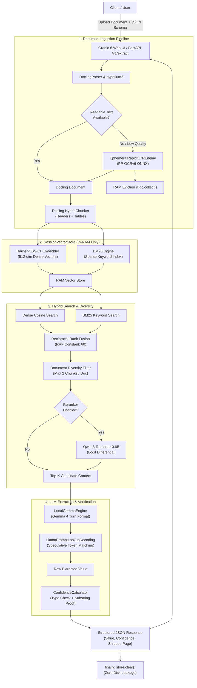

<p align="center">
  
</p>

<h1 align="center">DocNeedle</h1>

<p align="center">
  <strong>Privacy-First Local RAG Document Extraction Microservice</strong><br/>
  Extract structured key-value data with verified citations and confidence scores from documents (PDF, DOCX, XLSX, images) with zero disk leakage and local in-process AI models.
</p>

<p align="center">
  <a href="#quick-start"></a>
  <a href="#architecture"></a>
  <a href="#tech-stack"></a>
  <a href="#tech-stack"></a>
  <a href="#tech-stack"></a>
  <a href="#api-reference"></a>
  <a href="#license"></a>
</p>

---

## Table of Contents

- [Overview](#overview)
- [Key Features](#key-features)
- [Tech Stack](#tech-stack)
- [Prerequisites](#prerequisites)
- [Getting Started](#getting-started)
  - [1. Clone Repository](#1-clone-repository)
  - [2. System Dependencies](#2-system-dependencies)
  - [3. Virtual Environment with uv](#3-virtual-environment-with-uv)
  - [4. Install Dependencies](#4-install-dependencies)
  - [5. Download Quantized Models](#5-download-quantized-models)
  - [6. Environment Configuration](#6-environment-configuration)
  - [7. Launch Standalone Application](#7-launch-standalone-application)
- [Architecture & Technical Design](#architecture--technical-design)
  - [System Architecture](#system-architecture)
  - [Document Ingestion Pipeline](#document-ingestion-pipeline)
  - [Ephemeral RapidOCR Engine](#ephemeral-rapidocr-engine)
  - [Hybrid Retrieval (Dense + BM25 via RRF)](#hybrid-retrieval-dense--bm25-via-rrf)
  - [Extraction & Confidence Verification](#extraction--confidence-verification)
  - [Speculative Decoding & KV Cache Quantization](#speculative-decoding--kv-cache-quantization)
  - [Privacy Guarantee: Zero Disk Leakage](#privacy-guarantee-zero-disk-leakage)
  - [Asynchronous Job Processing & SSE Streaming](#asynchronous-job-processing--sse-streaming)
- [API Reference](#api-reference)
  - [Interactive Documentation (Swagger UI)](#interactive-documentation-swagger-ui)
  - [Supported Semantic Data Types](#supported-semantic-data-types)
  - [Extraction Contract & Confidence Scoring](#extraction-contract--confidence-scoring)
  - [1. Synchronous Extraction (`POST /v1/extract`)](#1-synchronous-extraction-post-v1extract)
  - [2. Submit Asynchronous Job (`POST /v1/jobs`)](#2-submit-asynchronous-job-post-v1jobs)
  - [3. Poll Job Status (`GET /v1/jobs/{job_id}`)](#3-poll-job-status-get-v1jobsjob_id)
  - [4. Stream Job Events via SSE (`GET /v1/jobs/{job_id}/events`)](#4-stream-job-events-via-sse-get-v1jobsjob_idevents)
  - [5. Health & Diagnostics (`GET /healthz`)](#5-health--diagnostics-get-healthz)
  - [HTTP Status & Error Codes](#http-status--error-codes)
  - [Client Integration Code Examples](#client-integration-code-examples)
- [Directory Structure](#directory-structure)
- [Environment Variables](#environment-variables)
- [Available Scripts & CLI](#available-scripts--cli)
- [Testing](#testing)
- [Deployment](#deployment)
  - [Docker & Docker Compose](#docker--docker-compose)
  - [Hugging Face Spaces](#hugging-face-spaces)
  - [Standalone Linux Server (systemd)](#standalone-linux-server-systemd)
- [Troubleshooting](#troubleshooting)
- [Contributing](#contributing)
- [License](#license)

---

## Overview

**DocNeedle** is a privacy-first, local in-process RAG (Retrieval-Augmented Generation) document extraction microservice. It allows organizations and individuals to extract structured key-value pairs (names, dates, IBANs, invoice amounts, contract terms, etc.) from arbitrary documents with verified textual citations and granular confidence scores.

Unlike cloud-based solutions or large agentic pipelines that ship sensitive records to third-party APIs or persist data in external vector databases:
- **Zero Disk Leakage:** Uploaded files and generated embeddings are processed strictly in RAM and permanently purged upon request completion.
- **Self-Contained Local AI:** Runs compact, quantized models (Gemma 4 E2B, Harrier-OSS, Qwen3, RapidOCR) directly in-process via `llama-cpp-python` and ONNX Runtime.
- **Dual Interface:** Offers both a unified dark-mode Gradio 6 web dashboard and a high-performance FastAPI REST API on the same port.

---

## Key Features

- **Strict Zero-Disk Privacy:** Document chunks, dense vectors, and temporary artifacts reside only in memory (`SessionVectorStore`). The memory is explicitly released in `finally:` blocks.
- **Free-Threaded Python 3.14t (No-GIL):** Runs without Python's Global Interpreter Lock, enabling high-throughput multi-threaded extraction and OCR execution without CPU bottlenecking.
- **Multi-Format Ingestion:** Ingests PDF (scanned & digital), DOCX, XLSX, PPTX, HTML, PNG, JPEG, and TIFF via IBM Docling and pypdfium2.
- **Smart Embedded Text & CMap Validation:** Scans digital PDFs first; if valid text exists, redundant OCR is skipped. Detects and handles corrupted ToUnicode CMaps automatically.
- **Ephemeral ONNX OCR Engine:** Loads RapidOCR (PP-OCRv6 Det-Small / Rec-Small ONNX) into memory only while parsing scanned documents and frees it immediately after transcription via a context manager.
- **Hybrid Vector & Keyword Retrieval:** Dense cosine similarity (Harrier-OSS 0.6B) and sparse BM25 scores (with Turkish-aware case folding) are fused using Reciprocal Rank Fusion (RRF, constant 60) with document diversity constraints.
- **Speculative Prompt Lookup Decoding:** Accelerates token generation using `LlamaPromptLookupDecoding` ($n$-gram reuse from the document context) with zero additional VRAM/RAM overhead.
- **8-Bit Quantized KV Cache:** Local llama.cpp instances configure `type_k=8` and `type_v=8` with FlashAttention, cutting context memory usage by 50% and supporting a 16k context window in ~4.4 GB RAM.
- **Verification & Strict Typings:** Built-in verification engine validates 16 semantic types (`iban`, `money`, `date`, `id`, `email`, etc.) and calculates confidence based on exact substring provenance and type constraints.
- **Real-Time Asynchronous SSE Streaming:** Submit extraction jobs via `POST /v1/jobs` and stream progress and field-by-field extracted items in real time via Server-Sent Events (`GET /v1/jobs/{id}/events`).

---

## Tech Stack

| Category | Component / Library | Details |
| :--- | :--- | :--- |
| **Runtime & Language** | Python 3.14t (Free-Threaded) | `PYTHON_GIL=0`, thread-safe C extensions guarded by locks |
| **Web UI** | Gradio 6+ | Unified dark theme UI, dynamic field schema builder, raw JSON viewer |
| **REST API** | FastAPI 0.115+, Uvicorn, Pydantic v2 | Async endpoints, multipart file uploads, SSE streaming |
| **Document Ingestion** | Docling 2.15+, pypdfium2 | Hybrid parsing, structural layout analysis, table parsing |
| **OCR Engine** | RapidOCR 3.0+ (PP-OCRv6 ONNX) | Ephemeral on-demand ONNX Runtime loader with RAM eviction |
| **Chunking** | Docling `HybridChunker` | Heading hierarchy preservation, table header replication |
| **Dense Embeddings** | Harrier-OSS-v1-0.6B (Q4_K_M GGUF / Q4 ONNX) | 512-dim MRL truncation, L2 normalization, in-process inference |
| **Sparse Keyword Search** | Rank-BM25 Engine | Okapi BM25 with Turkish-aware case folding and punctuation cleaning |
| **Reranking (Optional)** | Qwen3-Reranker-0.6B GGUF | Cross-encoder logit scoring via llama.cpp (opt-in on CPU) |
| **LLM Inference** | Gemma-4-E2B-it-qat-UD-Q4_K_XL GGUF | 4-bit quantized GGUF via `llama-cpp-python`, Gemma 4 turn format |
| **Package Manager** | Astral `uv` | Virtual environment management and fast reproducible resolution |
| **Containerization** | Docker & Docker Compose | Python 3.14-slim multi-stage build, llama.cpp server support |

---

## Prerequisites

Before running DocNeedle, ensure the following are installed:

1. **Python 3.14 Free-Threaded (`python3.14t`):**
   - DocNeedle is optimized for Python 3.14 with free-threading (`--disable-gil`). Astral `uv` can install this automatically:
     ```bash
     uv python install 3.14t
     ```
2. **uv (Astral):**
   - Fast Python package and environment manager (`>= 0.4.0`):
     ```bash
     curl -LsSf https://astral.sh/uv/install.sh | sh
     ```
3. **Operating System Libraries (Linux):**
   - OpenCV and RapidOCR require standard graphics and threading runtimes:
     ```bash
     # Ubuntu / Debian
     sudo apt-get update && sudo apt-get install -y build-essential curl git libgl1 libglib2.0-0

     # Fedora / RHEL
     sudo dnf install -y gcc-c++ mesa-libGL glib2

     # Arch Linux
     sudo pacman -S base-devel mesa glib2
     ```
4. **Hardware Requirements:**
   - **RAM:** Minimum 8 GB recommended (the complete pipeline runs comfortably inside ~4.4 GB RAM).
   - **CPU:** 4+ cores recommended (automatic core affinity detection scales batch threads).
   - **GPU (Optional):** NVIDIA GPU with CUDA driver if GPU acceleration is desired (`GPU_ENABLED=true`).

---

## Getting Started

### 1. Clone Repository

```bash
git clone https://github.com/your-username/DocNeedle.git
cd DocNeedle
```

### 2. System Dependencies

Ensure graphics and build libraries are present (see [Prerequisites](#prerequisites)).

### 3. Virtual Environment with uv

Create a virtual environment utilizing free-threaded Python 3.14:

```bash
uv venv --python 3.14t
source .venv/bin/activate
```

*(On Windows PowerShell: `.venv\Scripts\Activate.ps1`)*

### 4. Install Dependencies

Install the core package along with development and machine learning dependencies:

```bash
uv pip install -e ".[dev,ml]"
```

### 5. Download Quantized Models

DocNeedle uses local quantized models stored in the `models/` directory. Run the automated download utility:

```bash
uv run python scripts/download_models.py
```

This downloads:
- `models/embedding/harrier-oss-v1-0.6b.Q4_K_M.gguf` (~400 MB)
- `models/embedding/harrier-onnx/` (ONNX Q4 model + tokenizer)
- `models/reranker/Qwen3-Reranker-0.6B.Q4_K_M.gguf` (~420 MB)
- `models/llm/gemma-4-E2B-it-qat-UD-Q4_K_XL.gguf` (~1.6 GB)

> [!NOTE]
> You can download specific models individually:
> ```bash
> uv run python scripts/download_models.py --llm
> uv run python scripts/download_models.py --embedding
> uv run python scripts/download_models.py --reranker
> ```

### 6. Environment Configuration

Copy the example environment configuration:

```bash
cp .env.example .env
```

Review and adjust variables in `.env` if needed. Default values are pre-tuned for local CPU execution.

### 7. Launch Standalone Application

Run the unified application (Gradio 6 Dark Web UI + FastAPI REST API):

```bash
uv run python app.py
```

The service will start immediately:
- **Unified Web UI:** [http://localhost:7860](http://localhost:7860)
- **Interactive Swagger Documentation:** [http://localhost:7860/docs](http://localhost:7860/docs)
- **Alternative ReDoc API Docs:** [http://localhost:7860/redoc](http://localhost:7860/redoc)
- **Health Check Endpoint:** [http://localhost:7860/healthz](http://localhost:7860/healthz)

To launch in API-only development mode with hot-reloading:

```bash
uv run uvicorn docneedle.main:app --host 0.0.0.0 --port 8000 --reload
```

---

## Architecture & Technical Design

### System Architecture

The following diagram illustrates the complete request lifecycle and data flow inside DocNeedle:



### Document Ingestion Pipeline

1. **Format Handling:** The ingestion pipeline accepts PDF, DOCX, XLSX, PPTX, HTML, PNG, JPEG, and TIFF files.
2. **Digital Text First:** `_pdf_has_embedded_text()` scans up to `pdf_embedded_text_max_check_pages` pages using `pypdfium2`. If readable text exceeding `pdf_embedded_text_min_chars` is found without corrupted ToUnicode CMap symbols, expensive OCR is skipped entirely.
3. **CMap Garbled Detection:** Built-in heuristics detect broken font mappings (e.g., consonant runs $\ge 7$ chars, illegal Unicode ranges `0xE000-0xF8FF`, or corrupted glyph ratios $> 3\%$). When corruption is detected, the pipeline automatically falls back to OCR.
4. **Structural Chunking:** `DoclingChunker` splits parsed documents into coherent semantic segments using Docling's `HybridChunker`. It automatically propagates markdown heading breadcrumbs (`Heading 1 > Subheading`) into chunk metadata and repeats table headers across split table chunks (`chunker_repeat_table_header = True`).

### Ephemeral RapidOCR Engine

- **On-Demand Loading:** Unlike standard services that hold heavy OCR neural networks in memory indefinitely, `EphemeralRapidOCREngine` loads the ONNX runtime sessions only when an image or scanned document requires OCR.
- **Context-Managed Lifetime:**
  ```python
  with ingestion_service.parser:
      # EphemeralRapidOCREngine is loaded into RAM
      result = ingestion_service.ingest_bytes(content, filename)
  # RapidOCR is set to None and gc.collect() reclaims RAM immediately
  ```
- **Turkish Glyph Normalization:** Includes automatic detection of Turkish legal/notary documents and cleans typical Latin-1 / Eastern European OCR confusions (`Č` $\to$ `Ğ`, `Í` $\to$ `İ`, `Ġ` $\to$ `Ğ`).

### Hybrid Retrieval (Dense + BM25 via RRF)

DocNeedle fuses dense vector semantics with sparse exact-match keywords:

1. **Dense Embeddings:** `OnnxHarrierEmbedder` / `LlamaCppHarrierEmbedder` generates 512-dimensional Matryoshka-truncated, L2-normalized embeddings using Harrier-OSS-v1-0.6B.
2. **Sparse BM25:** `BM25Engine` tokenizes chunks with Turkish-aware case folding (`İ` $\to$ `i`, `I` $\to$ `ı`) and computes Okapi BM25 relevance scores ($k_1=1.5, b=0.75$).
3. **Reciprocal Rank Fusion (RRF):** Rankings from dense and sparse retrievals are merged:
   $$\text{RRF Score}(d) = \frac{1}{60 + \text{Rank}_{\text{dense}}(d)} + \frac{1}{60 + \text{Rank}_{\text{sparse}}(d)}$$
4. **Document Diversity:** An anti-starvation filter ensures no single document consumes more than `max_chunks_per_document` (default: 2) in the top-$K$ candidates.
5. **Cross-Encoder Reranker (Optional):** When enabled (`enable_reranker=True`), `Qwen3Reranker` computes the logit differential between "yes" and "no" output tokens for the query-document pair.

### Extraction & Confidence Verification

The extraction engine evaluates fields one-by-one or in batches using `LocalGemmaEngine`:

- **Gemma 4 Turn Format:**
  ```text
  <|turn>system
  You are a rigorous official document analysis assistant...<turn|>
  <|turn>user
  Document Context:
  ...
  Requested Field: monthly_rent
  Description: What is the agreed monthly rent?<turn|>
  <|turn>model
  ```
- **Type Verification:** Built-in rules validate 16 semantic data types:
  - `string`, `number`, `money`, `date`, `time`, `email`, `phone`, `id`, `iban`, `percentage`, `person`, `organization`, `address`, `boolean`, `list`.
- **Confidence Scoring:** `ConfidenceCalculator` assigns confidence scores based on:
  - Exact or fuzzy substring presence in the source chunk (0.96 for exact match, 0.88 for all-word match).
  - Validation against semantic type constraints (e.g. missing digits in `money` or malformed check digits in `iban` incur a $-0.20$ penalty).
  - Missing entities strictly return `found: False`, `value: None`, `confidence: 0.0`.

### Speculative Decoding & KV Cache Quantization

- **Prompt Lookup Decoding:** Configures `LlamaPromptLookupDecoding` (`num_pred_tokens=5`, `max_ngram_size=2`). Because extracted entity values (names, addresses, IBANs, numbers) almost always appear verbatim in the input document prompt, $n$-gram speculative decoding provides a $1.8\times - 2.5\times$ speedup on CPU inference with zero extra RAM cost.
- **8-Bit Quantized KV Cache:** Llama.cpp instances configure `type_k=8` and `type_v=8` (GGML_TYPE_Q8_0) with `flash_attn=True`. This reduces KV cache footprint by 50%, enabling a 16,384 context window within ~4.4 GB RAM.

### Privacy Guarantee: Zero Disk Leakage

DocNeedle guarantees zero disk residue for sensitive documents:
- Uploaded byte streams are parsed in RAM or temporary files that are deleted immediately in `finally:` blocks.
- Chunks and dense vectors are stored solely in `SessionVectorStore` in RAM.
- When an extraction request finishes, `store.clear()` is guaranteed to execute, resetting internal arrays and invoking Python garbage collection.

### Asynchronous Job Processing & SSE Streaming

For long documents or schemas with dozens of fields, DocNeedle provides an asynchronous job manager:
- `POST /v1/jobs` accepts files and schema, creates an in-memory job ID (`job_abc123`), and returns `202 Accepted` immediately.
- Background worker processes document ingestion, indexing, and sequential extraction.
- Clients connect to `GET /v1/jobs/{job_id}/events` via Server-Sent Events (SSE) to receive live progress updates (`progress`, `item_extracted`, `completed`, `error`).
- In-memory job state automatically expires after `job_retention_minutes` (default: 15 minutes).

---

## API Reference

### Interactive Documentation (Swagger UI)

DocNeedle provides interactive OpenAPI documentation and an embedded Swagger UI:
- **Swagger UI:** `http://localhost:7860/docs` (or `http://localhost:8000/docs` in API-only dev server mode)
- **ReDoc UI:** `http://localhost:7860/redoc`
- **OpenAPI Schema (JSON):** `http://localhost:7860/openapi.json`

Developers can inspect schemas, test file uploads, and execute queries directly from their browser without manual cURL configuration.

### Supported Semantic Data Types

The `schema` payload defines target fields as a JSON array of `ExtractionItemQuery` objects (`key`, `description`, `type`). The verification engine enforces strict validation and formatting across 16 semantic data types:

| Type | Description | Example Format / Typical Target |
| :--- | :--- | :--- |
| `string` | Unrestricted text or short sentence | Titles, notes, generic phrases |
| `number` | Numeric integer or float value | Quantity, units, floor count, score |
| `money` | Currency amounts and financial values | `25.000 TL`, `$1,250.00`, `€450` |
| `date` | Standard calendar dates | `15 Haziran 2026`, `2026-03-31`, `01/12/2025` |
| `time` | Clock times and durations | `14:30`, `09:00 AM`, `45 minutes` |
| `email` | RFC-compliant email address | `contact@acme.com` |
| `phone` | Local or international phone number | `+90 555 123 4567`, `(0212) 444 0 123` |
| `id` | Identification or registration numbers | National ID (TCKN), Passport, Tax ID, SSN |
| `iban` | International Bank Account Number | `TR33 0006 1005 1234 5678 9012 34` |
| `percentage` | Ratio, rate, or percentage figures | `18%`, `%20 KDV`, `4.5%` |
| `person` | Name of an individual person | `Tolga Arslan`, `Dr. Jane Doe` |
| `organization`| Company, institution, or legal entity | `Acme Corp Inc.`, `T.C. Maliye Bakanlığı` |
| `address` | Physical location or street address | `Barbaros Mah. Ak Zambak Sok. No: 3/A, Ataşehir` |
| `boolean` | Binary yes/no condition or clause presence | `true` / `false` |
| `list` | Delimited sequence of items | `Item A, Item B, Item C` |

> [!TIP]
> Formulating `description` as an explicit natural-language question (e.g. `"What is the agreed monthly rental fee?"`) maximizes retrieval accuracy and LLM comprehension.

### Extraction Contract & Confidence Scoring

- **Missing Entities:** If a requested field is not present in the ingested document, DocNeedle guarantees:
  ```json
  {
    "key": "field_name",
    "found": false,
    "value": null,
    "confidence": 0.0,
    "evidence": null,
    "thinking": null
  }
  ```
  The API **never** raises an exception for missing document content.
- **Confidence Score (`0.0` - `1.0`):** Combines dense/BM25 retrieval scores, cross-encoder reranker probabilities, exact substring provenance matches, and semantic type validation rules. A score $\ge 0.75$ indicates high verification confidence.
- **Evidence Provenance:** Every found field includes the exact source document name, 1-based page number, and original verbatim snippet where the fact was located.

---

### 1. Synchronous Extraction (`POST /v1/extract`)

Extracts requested fields from uploaded documents in a single synchronous call.

#### Request

- **Method:** `POST`
- **Path:** `/v1/extract`
- **Content-Type:** `multipart/form-data`

**Parameters:**
- `files` (required): One or more document files (PDF, DOCX, XLSX, PNG, etc.).
- `schema` (required): JSON string specifying target fields to extract.
- `enable_reranker` (optional, bool): Whether to apply Qwen3 cross-encoder reranking (default: `false`).

#### Example Schema

```json
[
  {
    "key": "contract_date",
    "description": "What is the commencement or execution date of this agreement?",
    "type": "date"
  },
  {
    "key": "monthly_rent",
    "description": "What is the agreed monthly rental amount and currency?",
    "type": "money"
  },
  {
    "key": "tenant_name",
    "description": "Full name of the tenant or lessee",
    "type": "person"
  },
  {
    "key": "tenant_iban",
    "description": "Bank account IBAN number for rent payments",
    "type": "iban"
  }
]
```

#### Example cURL

```bash
curl -X POST "http://localhost:7860/v1/extract" \
  -F "files=@contract.pdf" \
  -F 'schema=[{"key":"monthly_rent","description":"Monthly rental fee","type":"money"},{"key":"tenant_name","description":"Tenant full name","type":"person"}]'
```

#### Example Response (`200 OK`)

```json
{
  "status": "completed",
  "processing_time_ms": 1420.5,
  "total_items": 2,
  "found_items": 2,
  "results": [
    {
      "key": "monthly_rent",
      "found": true,
      "value": "25.000 TL",
      "confidence": 0.96,
      "evidence": {
        "document": "contract.pdf",
        "page": 1,
        "snippet": "Kira Bedeli: Aylık 25.000 TL olup her ayın 5. gününe kadar..."
      },
      "thinking": null
    },
    {
      "key": "tenant_name",
      "found": true,
      "value": "Tolga Arslan",
      "confidence": 0.95,
      "evidence": {
        "document": "contract.pdf",
        "page": 1,
        "snippet": "KİRACI: Tolga Arslan (T.C. Kimlik No: 12345678901)"
      },
      "thinking": null
    }
  ]
}
```

---

### 2. Submit Asynchronous Job (`POST /v1/jobs`)

Submits an asynchronous extraction job and returns immediately with tracking URLs.

#### Request

```bash
curl -X POST "http://localhost:7860/v1/jobs" \
  -F "files=@annual_report.pdf" \
  -F 'schema=[{"key":"revenue","description":"Total annual revenue","type":"money"}]'
```

#### Example Response (`202 Accepted`)

```json
{
  "job_id": "job_e982fa1b02cd",
  "status": "pending",
  "poll_url": "/v1/jobs/job_e982fa1b02cd",
  "events_url": "/v1/jobs/job_e982fa1b02cd/events",
  "created_at": 1729450410.12
}
```

---

### 3. Poll Job Status (`GET /v1/jobs/{job_id}`)

Polls current progress, partial extracted results, or final completed output.

#### Request

```bash
curl -X GET "http://localhost:7860/v1/jobs/job_e982fa1b02cd"
```

#### Example Response

```json
{
  "job_id": "job_e982fa1b02cd",
  "status": "extracting",
  "progress": {
    "current_step": "Extracted 1/2 fields. Next: 'net_income'",
    "total_items": 2,
    "completed_items": 1,
    "current_key": "net_income",
    "percent": 60.0
  },
  "created_at": 1729450410.12,
  "completed_at": null,
  "processing_time_ms": null,
  "results": [
    {
      "key": "revenue",
      "found": true,
      "value": "$12.4M",
      "confidence": 0.96,
      "evidence": {
        "document": "annual_report.pdf",
        "page": 3,
        "snippet": "Total consolidated revenue was $12.4M for FY2025."
      }
    }
  ],
  "response": null,
  "error": null
}
```

---

### 4. Stream Job Events via SSE (`GET /v1/jobs/{job_id}/events`)

Opens an HTTP Server-Sent Events stream to receive real-time notifications as each individual field is extracted.

#### Request

```bash
curl -N -H "Accept: text/event-stream" "http://localhost:7860/v1/jobs/job_e982fa1b02cd/events"
```

#### Event Stream Output

```text
event: status
data: {"status": "parsing", "progress": {"percent": 5.0, ...}, "results": []}

event: progress
data: {"status": "indexing", "progress": {"current_step": "Indexing 18 chunks in RAM...", "percent": 18.0}}

event: item_extracted
data: {"key": "revenue", "found": true, "value": "$12.4M", "confidence": 0.96, ...}

event: completed
data: {"status": "completed", "processing_time_ms": 2340.1, "total_items": 1, "found_items": 1, ...}
```

---

### 5. Health & Diagnostics (`GET /healthz`)

Returns operational diagnostics, free-threading status, active models, and CPU thread allocations.

#### Request

```bash
curl -X GET "http://localhost:7860/healthz"
```

#### Example Response

```json
{
  "status": "healthy",
  "service": "DocNeedle",
  "version": "0.1.0",
  "python_version": "3.14.4 experimental free-threading build",
  "free_threaded": true,
  "gil_enabled": false,
  "config": {
    "embedding_model": "microsoft/harrier-oss-v1-0.6b",
    "embedding_quantization": "q4_k_m",
    "llm_model": "gemma-4-E2B-it-qat-UD-Q4_K_XL",
    "llm_speculative_enabled": true,
    "ocr_enabled": true,
    "reranker_enabled": false,
    "gpu_enabled": false,
    "cpu_threads": 6
  }
}
```

---

### HTTP Status & Error Codes

DocNeedle follows strict REST conventions and a fail-fast error policy:

| HTTP Status | Name | Condition / Explanation |
| :--- | :--- | :--- |
| `200 OK` | Success | Synchronous extraction completed, status queried, or health check healthy. |
| `202 Accepted` | Accepted | Asynchronous extraction job created (`POST /v1/jobs`); background worker queued. |
| `400 Bad Request` | Bad Request | Missing file upload, invalid JSON schema syntax, or empty schema array. |
| `404 Not Found` | Not Found | Requested `job_id` does not exist or has expired from RAM (TTL retention limit). |
| `413 Payload Too Large` | Payload Too Large | Uploaded file size exceeds configured `MAX_UPLOAD_SIZE_MB` (default: 50 MB). |
| `422 Unprocessable Entity`| Unprocessable Entity | Ingestion engine could not extract readable text or OCR data from the uploaded file. |
| `500 Internal Server Error`| Server Error | Unexpected internal execution failure or model loading error. |

---

### Client Integration Code Examples

#### Python (`httpx` / `requests`) — Synchronous Extraction

```python
import json
import httpx

API_URL = "http://localhost:7860/v1/extract"

# 1. Define target extraction schema
schema = [
    {"key": "tenant_name", "description": "Who is the tenant?", "type": "person"},
    {"key": "monthly_rent", "description": "What is the monthly rental fee?", "type": "money"},
    {"key": "contract_date", "description": "Contract start date", "type": "date"},
]

# 2. Prepare multipart payload
with open("contract.pdf", "rb") as f:
    files = [("files", ("contract.pdf", f, "application/pdf"))]
    data = {"schema": json.dumps(schema), "enable_reranker": "false"}

    response = httpx.post(API_URL, files=files, data=data, timeout=60.0)
    response.raise_for_status()

result = response.json()
print(f"Extraction finished in {result['processing_time_ms']} ms.")
for item in result["results"]:
    print(f"[{item['key']}]: {item['value']} (confidence: {item['confidence']:.2f})")
    if item["evidence"]:
        print(f"   Source: Page {item['evidence']['page']} | Snippet: {item['evidence']['snippet']}")
```

#### JavaScript / TypeScript (Browser / Node.js) — Asynchronous SSE Stream

```javascript
// 1. Submit extraction job
async function startExtractionJob(file, schema) {
  const formData = new FormData();
  formData.append("files", file);
  formData.append("schema", JSON.stringify(schema));

  const response = await fetch("http://localhost:7860/v1/jobs", {
    method: "POST",
    body: formData,
  });

  if (!response.ok) {
    throw new Error(`Job creation failed: ${response.statusText}`);
  }

  const { job_id, events_url } = await response.json();
  console.log(`Job queued: ${job_id}`);

  // 2. Stream real-time events via Server-Sent Events (SSE)
  const eventSource = new EventSource(`http://localhost:7860${events_url}`);

  eventSource.addEventListener("progress", (event) => {
    const { progress } = JSON.parse(event.data);
    console.log(`Progress: ${progress.percent}% - ${progress.current_step}`);
  });

  eventSource.addEventListener("item_extracted", (event) => {
    const item = JSON.parse(event.data);
    console.log(`Extracted field: [${item.key}] = ${item.value} (Confidence: ${item.confidence})`);
  });

  eventSource.addEventListener("completed", (event) => {
    const finalResponse = JSON.parse(event.data);
    console.log("Extraction complete! Final results:", finalResponse.results);
    eventSource.close();
  });

  eventSource.addEventListener("error", (error) => {
    console.error("SSE stream error:", error);
    eventSource.close();
  });
}
```

---

## Directory Structure

```
DocNeedle/
├── assets/                     # Static branding (logo.svg, logo.png, favicon.svg)
├── app.py                      # Standalone entry point: Unified Gradio 6 UI + FastAPI root mount
├── pyproject.toml              # Project specification, dependencies, ruff & pytest configurations
├── uv.lock                     # Astral uv reproducible dependency lockfile
├── Dockerfile                  # Container definition (Python 3.14-slim, free-threaded)
├── docker-compose.yml          # Multi-container setup (DocNeedle backend + llama.cpp server)
├── .env.example                # Documented configuration template
├── AGENTS.md                   # Agentic developer contract and architecture rules
├── README.md                   # Comprehensive technical documentation
├── scripts/
│   └── download_models.py      # Automated CLI utility for downloading local quantized models
├── models/                     # Local model storage directory (git-ignored)
│   ├── embedding/              # Harrier-OSS-v1 GGUF and ONNX models
│   ├── reranker/               # Qwen3-Reranker-0.6B GGUF
│   └── llm/                    # Gemma-4-E2B-it-qat-UD-Q4_K_XL GGUF
├── src/docneedle/
│   ├── main.py                 # FastAPI initialization, CORS middleware, and /healthz
│   ├── config.py               # Central Pydantic BaseSettings & CPU core detection
│   ├── api/
│   │   ├── routes_extract.py   # Synchronous extraction endpoint (POST /v1/extract)
│   │   └── routes_jobs.py      # Async jobs & SSE routes (POST /v1/jobs, GET /v1/jobs/{id}/events)
│   ├── jobs/
│   │   ├── models.py           # JobStatus, JobProgress, JobCreateResponse, JobStatusResponse
│   │   └── manager.py          # Thread-safe in-memory JobManager (RAM cache & TTL eviction)
│   ├── ingest/
│   │   ├── parser.py           # Docling parser, pypdfium2 inspector, and CMap validator
│   │   ├── ocr_engine.py       # EphemeralRapidOCREngine (PP-OCRv6 ONNX with RAM eviction)
│   │   ├── chunker.py          # DoclingChunker (HybridChunker, table headers, headings)
│   │   ├── cache.py            # Ingestion document caching utilities
│   │   ├── service.py          # IngestionService coordinator
│   │   └── models.py           # DocumentChunk and IngestionResult data models
│   ├── retrieval/
│   │   ├── embedder.py         # OnnxHarrierEmbedder & LlamaCppHarrierEmbedder
│   │   ├── bm25.py             # BM25Engine (Okapi BM25 with Turkish-aware case folding)
│   │   ├── reranker.py         # Qwen3Reranker (cross-encoder logit scoring via llama.cpp)
│   │   ├── store.py            # SessionVectorStore (in-memory RRF fusion & document diversity)
│   │   └── models.py           # SearchResult model
│   ├── extraction/
│   │   ├── service.py          # ExtractionService coordinator & retrieval query synthesis
│   │   ├── verifier.py         # ConfidenceCalculator (substring matching & type constraints)
│   │   └── schemas.py          # ExtractionItemQuery, ExtractionItemResult, ExtractionResponse
│   └── llm/
│       ├── local_engine.py     # LocalGemmaEngine (Gemma 4 turn formatting & speculative decoding)
│       └── client.py           # LLMClient interface
└── tests/                      # Automated test suite (Pytest)
    ├── test_clean_modules.py   # Modular clean architecture and unit tests
    ├── test_extraction.py      # End-to-end extraction tests
    ├── test_health.py          # Health check endpoint tests
    ├── test_ingest.py          # Ingestion and parsing tests
    ├── test_jobs.py            # Asynchronous job manager and SSE streaming tests
    ├── test_ocr_grounding.py   # OCR layout geometry and CMap corruption tests
    ├── test_retrieval.py       # Hybrid RRF and BM25 search tests
    ├── test_speculative.py     # Speculative decoding prompt lookup tests
    └── test_ui_schema_sync.py  # Gradio UI schema synchronization tests
```

---

## Environment Variables

All settings can be configured via environment variables or a `.env` file in the project root:

| Variable | Type | Default | Description |
| :--- | :--- | :--- | :--- |
| **Server & App** | | | |
| `APP_NAME` | string | `DocNeedle` | Application name displayed in API responses |
| `APP_VERSION` | string | `0.1.0` | Semantic version string |
| `DEBUG` | bool | `false` | Enable verbose debug logging |
| `HOST` | string | `0.0.0.0` | Host interface to bind server |
| `PORT` | int | `8000` | Port for standalone FastAPI (7860 when launched via `app.py`) |
| `CORS_ORIGINS` | list | `["*"]` | Allowed HTTP origins for CORS |
| **Ingestion & OCR** | | | |
| `MODEL_STORAGE_DIR` | string | `models` | Base directory containing local model weights |
| `MAX_UPLOAD_SIZE_MB` | int | `50` | Maximum upload size per file in megabytes |
| `OCR_ENABLED` | bool | `true` | Enable OCR fallback for scanned documents and images |
| `OCR_DET_MODEL_TYPE` | string | `small` | RapidOCR detection tier (`small` or `medium`) |
| `OCR_REC_MODEL_TYPE` | string | `small` | RapidOCR recognition tier (`small` or `medium`) |
| `OCR_TEXT_SCORE` | float | `0.5` | Minimum OCR text recognition confidence threshold |
| `OCR_LONGEST_EDGE` | int | `1000` | Maximum image dimension during OCR downscaling |
| `MAX_OCR_PAGES` | int | `15` | Maximum number of pages to transcribe via OCR per file |
| `OCR_PDF_RENDER_SCALE` | float | `1.6` | PyPDFium2 DPI render scaling factor for OCR |
| `PDF_EMBEDDED_TEXT_MIN_CHARS` | int | `50` | Minimum chars to confirm readable digital text |
| **Chunking** | | | |
| `CHUNKER_TOKENIZER_MODEL` | string | `Qwen/Qwen3-Reranker-0.6B` | Offline Hugging Face tokenizer identifier |
| `CHUNKER_MAX_TOKENS` | int | `768` | Maximum token capacity per chunk |
| `CHUNKER_REPEAT_TABLE_HEADER` | bool | `true` | Replicate table headers across split table chunks |
| `CHUNKER_MERGE_PEERS` | bool | `true` | Merge adjacent small paragraph chunks |
| **Retrieval & BM25** | | | |
| `BM25_K1` | float | `1.5` | BM25 term frequency saturation parameter |
| `BM25_B` | float | `0.75` | BM25 document length normalization parameter |
| `BM25_TOP_K` | int | `10` | Number of sparse matches evaluated in fusion |
| `EMBEDDING_DIMENSION` | int | `512` | Dense embedding dimension (MRL truncated) |
| `EMBEDDING_BATCH_SIZE` | int | `4` | Batch size for dense embedding computation |
| `RETRIEVAL_TOP_K` | int | `10` | Final candidate chunks passed to extraction |
| `RRF_CONSTANT` | int | `60` | Reciprocal Rank Fusion smoothing constant ($k$) |
| `MAX_CHUNKS_PER_DOCUMENT` | int | `2` | Maximum chunks per document for diversity |
| `RERANKER_ENABLED` | bool | `false` | Enable cross-encoder reranking by default on CPU |
| `RERANKER_CANDIDATE_K` | int | `4` | Number of candidate chunks sent to reranker |
| **LLM & Inference** | | | |
| `LLM_MODEL_NAME` | string | `gemma-4-E2B-it-qat-UD-Q4_K_XL` | Local GGUF model filename in `models/llm/` |
| `LLM_N_CTX` | int | `16384` | Context window size in tokens |
| `LLM_TEMPERATURE` | float | `0.0` | Sampling temperature (0.0 for deterministic extraction) |
| `LLM_TOP_P` | float | `0.95` | Top-$p$ nucleus sampling cutoff |
| `LLM_MAX_TOKENS` | int | `2048` | Maximum output tokens per generation request |
| `LLM_SINGLE_FIELD_MAX_TOKENS` | int | `128` | Maximum output tokens for single-field extraction |
| `LLM_SPECULATIVE_ENABLED` | bool | `true` | Enable Prompt Lookup Speculative Decoding |
| `LLM_SPECULATIVE_NUM_PRED_TOKENS`| int | `5` | Number of speculative tokens predicted per step |
| `LLM_SPECULATIVE_MAX_NGRAM_SIZE` | int | `2` | N-gram window size for prompt lookup matching |
| `JOB_RETENTION_MINUTES` | int | `15` | Time-to-live (TTL) for in-memory job records |
| **Hardware Acceleration** | | | |
| `GPU_ENABLED` | bool | `false` | Enable CUDA GPU offloading for llama.cpp |
| `LLM_N_GPU_LAYERS` | int | `0` | Number of layers to offload to GPU (`-1` for all) |
| `CPU_THREADS` | int | *(auto)* | Physical CPU threads for generation (auto-detected) |
| `CPU_THREADS_BATCH` | int | *(auto)* | CPU threads for prompt processing & batch embeddings |
| `MODEL_KV_CACHE_TYPE_K` | int | `8` | 8-bit quantized Key cache (`GGML_TYPE_Q8_0`) |
| `MODEL_KV_CACHE_TYPE_V` | int | `8` | 8-bit quantized Value cache (`GGML_TYPE_Q8_0`) |
| `MODEL_FLASH_ATTN` | bool | `true` | Enable FlashAttention in llama.cpp |

---

## Available Scripts & CLI

| Command | Description |
| :--- | :--- |
| `uv run python app.py` | Launch the unified Gradio 6 UI + FastAPI root service (port 7860) |
| `uv run uvicorn docneedle.main:app --reload` | Run API-only dev server with hot reload (port 8000) |
| `uv run python scripts/download_models.py` | Download all required quantized models from Hugging Face |
| `uv run python scripts/download_models.py --llm` | Download only the Gemma 4 LLM model |
| `uv run python scripts/download_models.py --embedding`| Download only the Harrier-OSS embedding model |
| `uv run python scripts/download_models.py --reranker` | Download only the Qwen3 reranker model |
| `uv run python scripts/download_models.py --onnx` | Download only the Harrier-OSS ONNX model and tokenizer |
| `uv run pytest` | Execute the complete automated test suite |
| `uv run pytest tests/test_clean_modules.py` | Run clean architecture and modular unit tests |
| `uv run pytest tests/test_jobs.py` | Run asynchronous job and SSE streaming tests |
| `uv run ruff check .` | Run Ruff linter across the entire codebase |
| `uv run ruff format .` | Format codebase using Ruff formatter |

---

## Testing

DocNeedle includes an automated Pytest test suite covering all modules:

```bash
# Run all tests
uv run pytest

# Run with verbose output and test execution durations
uv run pytest -v --durations=10

# Run a specific test file
uv run pytest tests/test_retrieval.py
```

### Test Suite Structure

| Test File | Primary Coverage |
| :--- | :--- |
| `tests/test_clean_modules.py` | Unit tests for configuration, parsing, verifier, schemas, and embedders |
| `tests/test_extraction.py` | ExtractionService orchestration, prompt synthesis, and batch execution |
| `tests/test_health.py` | `GET /healthz` endpoint, runtime GIL check, and diagnostics |
| `tests/test_ingest.py` | DoclingParser, document stream conversion, and chunk metadata |
| `tests/test_jobs.py` | Asynchronous JobManager, SSE event dispatching, and RAM TTL cleanup |
| `tests/test_ocr_grounding.py` | RapidOCR geometry, bounding box clustering, and CMap corruption detection |
| `tests/test_retrieval.py` | SessionVectorStore, BM25 indexing, cosine similarity, and RRF fusion |
| `tests/test_speculative.py` | Prompt lookup speculative decoding speedup and $n$-gram validation |
| `tests/test_ui_schema_sync.py` | Gradio UI dynamic field state synchronization and JSON serialization |

---

## Deployment

### Docker & Docker Compose

DocNeedle includes a multi-container Docker Compose configuration pairing the DocNeedle microservice with a dedicated `llama-server` container:

```bash
# Build and start services
docker compose up --build -d

# View container logs
docker compose logs -f backend

# Stop services
docker compose down
```

The services will be available at:
- **DocNeedle Unified App:** `http://localhost:7860`
- **DocNeedle API:** `http://localhost:8000`
- **llama.cpp Server:** `http://localhost:8080`

### Hugging Face Spaces

DocNeedle runs out-of-the-box on Hugging Face Spaces:
1. Create a new Space with the **Gradio** SDK.
2. Push this repository to the Space remote.
3. The Space will automatically execute `app.py`.
4. `scripts/download_models.py` boots missing quantized models automatically into ephemeral space storage upon initial startup.

### Standalone Linux Server (systemd)

To deploy DocNeedle as a persistent systemd service on Ubuntu/Debian:

1. Create a service file at `/etc/systemd/system/docneedle.service`:
   ```ini
   [Unit]
   Description=DocNeedle Document Extraction Service
   After=network.target

   [Service]
   Type=simple
   User=www-data
   WorkingDirectory=/opt/DocNeedle
   Environment="PATH=/opt/DocNeedle/.venv/bin:/usr/local/bin:/usr/bin"
   EnvironmentFile=/opt/DocNeedle/.env
   ExecStart=/opt/DocNeedle/.venv/bin/python app.py
   Restart=always
   RestartSec=5

   [Install]
   WantedBy=multi-user.target
   ```

2. Enable and start the service:
   ```bash
   sudo systemctl daemon-reload
   sudo systemctl enable docneedle
   sudo systemctl start docneedle
   sudo systemctl status docneedle
   ```

---

## Troubleshooting

### 1. `python3.14t: command not found`
**Cause:** Python 3.14 free-threaded binary is not installed in the system PATH.  
**Solution:** Use `uv` to automatically fetch and manage the free-threaded build:
```bash
uv python install 3.14t
uv venv --python 3.14t
source .venv/bin/activate
```

### 2. `FileNotFoundError: No model found at models/...`
**Cause:** Model weights have not been downloaded yet.  
**Solution:** Run the download script to fetch all models from Hugging Face:
```bash
uv run python scripts/download_models.py
```

### 3. `ImportError: libGL.so.1: cannot open shared object file`
**Cause:** Missing OpenGL dependencies required by OpenCV and RapidOCR.  
**Solution:** Install graphics libraries on your Linux host:
```bash
# Ubuntu / Debian
sudo apt-get install -y libgl1 libglib2.0-0

# Fedora / CentOS
sudo dnf install -y mesa-libGL glib2
```

### 4. `Garbled / Corrupted Text in Scanned PDF`
**Cause:** A digital PDF has an invalid or corrupted ToUnicode CMap table.  
**Behavior:** DocNeedle automatically detects corrupted CMap tables (e.g. `÷`, `ø`, `þ` glyphs or consonant runs) and falls back to RapidOCR. If you suspect text is being misread, force OCR by setting:
```bash
OCR_FALLBACK_MIN_CHARS=100
```

### 5. `Port 7860 or 8000 already in use`
**Cause:** Another instance of DocNeedle or Uvicorn is already running.  
**Solution:** Specify a different port via environment variable:
```bash
PORT=8080 uv run python app.py
```

---

## Contributing

Contributions to DocNeedle are welcome! Please adhere to the following workflow:

1. **Fork the repository** and create a feature branch (`git checkout -b feature/amazing-feature`).
2. **Adhere to Code Standards:**
   - All code comments and identifiers must be in English.
   - Run Ruff linter and formatter:
     ```bash
     uv run ruff check .
     uv run ruff format .
     ```
3. **Verify All Tests Pass:**
   ```bash
   uv run pytest
   ```
4. **Strict No-Fallback Policy:** Maintain explicit fail-fast behavior. Do not introduce silent fallbacks or mock degradations unless explicitly approved.
5. **Submit a Pull Request** with a detailed description of your changes.

---

## License

This project is licensed under the Apache 2.0 License. See the [LICENSE](LICENSE) file for details.
