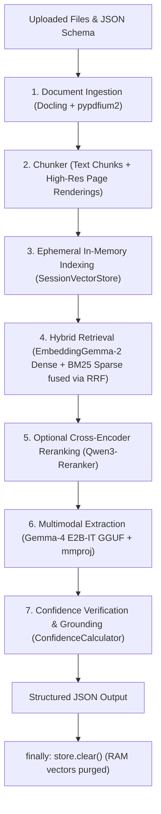

<p align="center">
  
</p>

<h1 align="center">DocNeedle</h1>

<p align="center">
  <strong>Privacy-First Local RAG Document Extraction Microservice & Standalone UI</strong><br/>
  Extract structured key-value data with verified citations and confidence scores using local in-process AI models.<br/>
  Zero external API calls, zero disk leakage, and OCR-free visual RAG.
</p>

<p align="center">
  
  
  
  
  
  
</p>

---

## Table of Contents

- [Overview](#overview)
- [Key Features](#key-features)
- [Tech Stack](#tech-stack)
- [Prerequisites](#prerequisites)
- [Getting Started](#getting-started)
  - [1. Clone Repository](#1-clone-repository)
  - [2. Install System Dependencies](#2-install-system-dependencies)
  - [3. Setup Python 3.14t Environment with `uv`](#3-setup-python-314t-environment-with-uv)
  - [4. Install Project Dependencies](#4-install-project-dependencies)
  - [5. Download Quantized Models](#5-download-quantized-models)
  - [6. Configuration](#6-configuration)
  - [7. Launch the Application](#7-launch-the-application)
- [System Architecture](#system-architecture)
  - [Directory Structure](#directory-structure)
  - [End-to-End Extraction Lifecycle](#end-to-end-extraction-lifecycle)
  - [Data Flow](#data-flow)
  - [Zero-Disk Privacy Guarantee](#zero-disk-privacy-guarantee)
  - [Supported Data Types](#supported-data-types)
- [API Reference](#api-reference)
  - [Endpoints Overview](#endpoints-overview)
  - [Synchronous Extraction (`POST /v1/extract`)](#synchronous-extraction-post-v1extract)
  - [Asynchronous Job Creation (`POST /v1/jobs`)](#asynchronous-job-creation-post-v1jobs)
  - [Job Status Polling (`GET /v1/jobs/{job_id}`)](#job-status-polling-get-v1jobsjob_id)
  - [Real-Time SSE Streaming (`GET /v1/jobs/{job_id}/events`)](#real-time-sse-streaming-get-v1jobsjob_idevents)
  - [Health & Diagnostics (`GET /healthz`)](#health--diagnostics-get-healthz)
- [Configuration Reference](#configuration-reference)
  - [Configuration File (`config.toml`)](#configuration-file-configtoml)
  - [Environment Variables](#environment-variables)
- [Available Scripts & Commands](#available-scripts--commands)
- [Testing](#testing)
  - [Running the Test Suite](#running-the-test-suite)
  - [Test Suite Organization](#test-suite-organization)
  - [Important Note on Dev Server VRAM](#important-note-on-dev-server-vram)
- [Production Deployment](#production-deployment)
  - [Docker & Docker Compose](#docker--docker-compose)
  - [Hugging Face Spaces (ZeroGPU)](#hugging-face-spaces-zerogpu)
  - [Bare-Metal / Systemd Service](#bare-metal--systemd-service)
- [Troubleshooting & FAQs](#troubleshooting--faqs)
- [Contributing](#contributing)
- [License](#license)

---

## Overview

**DocNeedle** is a privacy-first, local document information extraction microservice and web application. It takes raw, unstructured documents (**PDF**, **DOCX**, **XLSX**, and high-resolution **images**) alongside a user-defined JSON schema, and extracts target values paired with exact textual citations, source document provenance, page numbers, and statistical confidence scores.

Unlike traditional document extraction pipelines, DocNeedle operates with:
- **Zero Cloud Reliance:** All neural models run locally in-process via `llama-cpp-python` with native CUDA/cuBLAS acceleration.
- **Zero Disk Leakage:** Uploaded document payloads, vector embeddings, and search indices reside strictly in volatile RAM and are purged immediately after execution.
- **OCR-Free Visual RAG:** Digital PDFs are parsed for structural text, while scanned documents and images are ingested as high-resolution visual page chunks. Purely visual pages are embedded cross-modally via the SigLIP vision projector (`mmproj-F16.gguf`) and extracted directly by the multimodal Gemma-4 LLM, completely bypassing fragile OCR engines.

---

## Key Features

- **Strict Zero-Disk Privacy Guarantee:** Memory vector store (`SessionVectorStore`) is in-memory only. Vectors, chunks, and temp files are cleared in `finally: store.clear()`. Nothing is saved to external vector databases or disk.
- **In-Process Multimodal Neural Models:**
  - **LLM:** Gemma-4 E2B-IT GGUF (`gemma-4-E2B-it-qat-UD-Q4_K_XL.gguf` + `mmproj-F16.gguf`) with schema-constrained JSON extraction.
  - **Cross-Modal Embedder:** EmbeddingGemma-2 GGUF (`embeddinggemma-2-UD-Q4_K_XL.gguf` + `mmproj-F16.gguf`) for unified dense text and visual page embeddings.
  - **Reranker:** Qwen3-Reranker-0.6B GGUF (`Qwen3-Reranker-0.6B.Q4_K_M.gguf`) for optional cross-encoder logit scoring.
- **Python 3.14t Free-Threaded (No-GIL):** True multi-core parallelism across parsing, chunking, and HTTP concurrency without Python Global Interpreter Lock contention.
- **8-Bit Quantized KV Cache:** Llama.cpp instances configure `type_k=8` and `type_v=8` (`GGML_TYPE_Q8_0`) with Flash Attention, cutting context RAM by 50% and enabling a 16,384 token window within ~4.4 GB RAM.
- **Speculative Prompt Lookup Decoding:** Automatically accelerates in-process token generation via `LlamaPromptLookupDecoding` (`max_ngram_size=2`, `num_pred_tokens=5` CPU / `10` GPU).
- **Hybrid RRF Retrieval:** Dense cosine similarity and sparse Okapi BM25 keyword matching are fused via Reciprocal Rank Fusion ($RRF=60$) with document diversity limits.
- **Unified Standalone UI + REST API:** Dark-mode Gradio 6 dashboard running on the exact same port (`7860`) as the full FastAPI REST API, featuring real-time Server-Sent Events (SSE) streaming for asynchronous background jobs.
- **ZeroGPU & Multi-Arch CUDA Ready:** Precompiled CUDA cubin libraries for `sm_80`, `sm_86`, `sm_89`, and `sm_120a` architectures with seamless ZeroGPU dynamic leasing via `@spaces.GPU`.

---

## Tech Stack

| Layer | Technologies |
| :--- | :--- |
| **Runtime & Language** | Python 3.14t (Free-Threaded, PEP 703 No-GIL) |
| **Microservice Framework** | FastAPI 0.115+, Uvicorn 0.32+, Pydantic v2, Pydantic-Settings |
| **Web Dashboard** | Gradio 6.30+, Dark Mode, Dynamic Schema Builder, Dual Formatted/Raw JSON Tabs |
| **Document Ingestion** | Docling Core 2.15+, pypdfium2 (high-res rendering), python-docx, openpyxl, Pillow |
| **Neural Embeddings** | EmbeddingGemma-2 UD-Q4_K_XL GGUF + SigLIP mmproj-F16 (768 dimensions) |
| **Lexical Search** | rank-bm25 (Okapi BM25) |
| **Cross-Encoder Reranker**| Qwen3-Reranker-0.6B Q4_K_M GGUF (via llama.cpp logit evaluation) |
| **Multimodal LLM Engine**| Gemma-4 E2B-IT GGUF (Q4_K_XL) + mmproj-F16 (16k context, 8-bit KV cache) |
| **Inference Backend** | llama-cpp-python 0.3.x with native CUDA/cuBLAS bindings |
| **Package Management** | `uv` (Astral) |
| **Container & Cloud** | Docker, Docker Compose, Hugging Face Spaces (Zero-A10G ZeroGPU) |

---

## Prerequisites

Before setting up DocNeedle, ensure your host system satisfies the following requirements:

### Operating System & Hardware
- **OS:** Linux (Ubuntu 22.04/24.04, Debian 12, Arch, or Fedora recommended). macOS and Windows WSL2 are supported.
- **RAM:** Minimum 8 GB (16 GB recommended for CPU-only inference).
- **GPU (Optional, Highly Recommended):** NVIDIA GPU with CUDA 12.0+ (Compute Capability $\ge$ 8.0: RTX 30/40/50 series, A100, H100, Blackwell). DocNeedle runs comfortably on 8 GB VRAM.
- **Storage:** ~5 GB free space for quantized model weights and tokenizers.

### System Packages (Linux)
Document parsing (Docling/pypdfium2) and graphical image processing require OpenGL and GLib shared libraries:

```bash
# Ubuntu / Debian
sudo apt-get update && sudo apt-get install -y \
    build-essential \
    cmake \
    curl \
    git \
    libgl1 \
    libglib2.0-0

# Fedora / RHEL
sudo dnf install -y gcc gcc-c++ cmake curl git mesa-libGL glib2

# Arch Linux
sudo pacman -S base-devel cmake curl git mesa glib2
```

### Package Manager
DocNeedle uses [`uv`](https://github.com/astral-sh/uv) for fast, deterministic Python environment management:

```bash
curl -LsSf https://astral.sh/uv/install.sh | sh
```

---

## Getting Started

Follow these steps to set up DocNeedle on a clean development machine:

### 1. Clone Repository

```bash
git clone https://github.com/N4YuC4/DocNeedle.git
cd DocNeedle
```

### 2. Install System Dependencies

Ensure the required libraries are installed (see [Prerequisites](#prerequisites)):

```bash
sudo apt-get install -y libgl1 libglib2.0-0
```

### 3. Setup Python 3.14t Environment with `uv`

DocNeedle is built for Python 3.14t (free-threaded, GIL disabled). `uv` handles downloading and managing free-threaded Python binaries automatically:

```bash
# Install free-threaded Python 3.14t
uv python install 3.14t

# Create virtual environment with GIL disabled
uv venv --python 3.14t

# Activate the virtual environment
source .venv/bin/activate
```

Verify your Python interpreter is running free-threaded:

```bash
python -c "import sys; print('Free-threaded (No-GIL):', not getattr(sys, '_is_gil_enabled', lambda: True)())"
# Output should be: Free-threaded (No-GIL): True
```

### 4. Install Project Dependencies

Install all core dependencies and development tools:

```bash
uv sync
```

> [!NOTE]
> If compiling `llama-cpp-python` with CUDA acceleration locally, ensure CUDA toolkit paths are exported:
> ```bash
> export CUDACXX=/usr/local/cuda/bin/nvcc
> export CMAKE_ARGS="-DGGML_CUDA=on -DCMAKE_CUDA_ARCHITECTURES=native"
> uv pip install --no-build-isolation "llama-cpp-python>=0.3.0,<0.4.0"
> ```

### 5. Download Quantized Models

DocNeedle relies on compact, high-precision quantized GGUF models. Run the automated model downloader script:

```bash
uv run python scripts/download_models.py
```

This downloads the required models into the `models/` directory (~4.5 GB total):
- `models/embedding/embeddinggemma-2-UD-Q4_K_XL.gguf` (Cross-modal embedder)
- `models/embedding/mmproj-F16.gguf` (Vision projector for embedder)
- `models/reranker/Qwen3-Reranker-0.6B.Q4_K_M.gguf` (Cross-encoder reranker)
- `models/llm/gemma-4-E2B-it-qat-UD-Q4_K_XL.gguf` (Multimodal Gemma-4 IT LLM)
- `models/llm/mmproj-F16.gguf` (Vision projector for LLM)
- Hugging Face chunker tokenizer: `Qwen/Qwen3-Reranker-0.6B`

*To download individual models selectively, pass `--embedding`, `--reranker`, or `--llm` flags to the script.*

### 6. Configuration

DocNeedle loads configuration from `config.toml` by default. You can inspect or customize settings:

```bash
# Optional: copy example environment file if you wish to override via env vars
cp .env.example .env 2>/dev/null || touch .env
```

Key default configurations in `config.toml`:
- `gpu_enabled = true`: Enables CUDA offloading if available. Set to `false` for CPU-only.
- `llm_n_gpu_layers = -1`: Offloads all layers to GPU (`0` runs on CPU).
- `reranker_enabled = false`: Disabled by default on CPU for ultra-low latency; enable for maximum citation precision.

### 7. Launch the Application

#### Option A: Unified Gradio Web Dashboard + FastAPI REST API (Default)

Launch the unified server hosting both the web UI and the complete REST API on port `7860`:

```bash
uv run python app.py
```

Once running, access the services:
- **Gradio Web Dashboard:** [http://localhost:7860](http://localhost:7860)
- **Interactive Swagger OpenAPI Docs:** [http://localhost:7860/docs](http://localhost:7860/docs)
- **ReDoc Documentation:** [http://localhost:7860/redoc](http://localhost:7860/redoc)
- **Health & Hardware Diagnostics:** [http://localhost:7860/healthz](http://localhost:7860/healthz)

#### Option B: Standalone API-Only Server

If you only need the headless REST microservice without the Gradio UI:

```bash
uv run uvicorn docneedle.main:app --host 0.0.0.0 --port 8000 --reload
```

---

## System Architecture

### Directory Structure

```
DocNeedle/
├── assets/                       # Branding logo (SVG) and static UI icons
├── app.py                        # Unified Gradio 6 UI + FastAPI root mount & ZeroGPU entry
├── config.toml                   # Primary application, model & pipeline configuration
├── pyproject.toml                # Project specification, dependencies, build settings & tools
├── requirements.txt              # Standard pip-compatible dependency specification
├── Dockerfile                    # Multi-stage Python 3.14-slim container specification
├── docker-compose.yml            # Standalone container orchestration configuration
├── scripts/
│   ├── download_models.py        # Model downloader with progress tracking and verification
│   └── deploy_space.sh           # One-click deployment to Hugging Face Spaces (ZeroGPU)
├── models/                       # Local model storage (GGUF weights and vision projectors)
│   ├── embedding/                # EmbeddingGemma-2 GGUF & SigLIP mmproj-F16
│   ├── reranker/                 # Qwen3-Reranker-0.6B Q4_K_M GGUF
│   └── llm/                      # Gemma-4-E2B-IT GGUF & SigLIP mmproj-F16
├── src/docneedle/
│   ├── main.py                   # FastAPI application factory, CORS, and /healthz endpoint
│   ├── config.py                 # Central Pydantic BaseSettings (TOML + env var loading)
│   ├── cuda_compat.py            # ZeroGPU preloaders & dynamic memory leasing wrappers
│   ├── api/
│   │   ├── routes_extract.py     # POST /v1/extract (synchronous extraction endpoint)
│   │   ├── routes_jobs.py        # POST /v1/jobs, GET /v1/jobs/{id}, GET /v1/jobs/{id}/events
│   │   └── validation.py         # File size checks, payload reading & JSON schema validation
│   ├── jobs/                     # Asynchronous background job worker & SSE event broadcasting
│   │   ├── models.py             # JobStatus, JobProgress, JobCreateResponse, JobStatusResponse
│   │   └── manager.py            # In-memory job registry, subscriber queues & TTL eviction
│   ├── ingest/                   # Document parsing & chunking subsystem
│   │   ├── parser.py             # Docling parser + pypdfium2 high-res rendering (OCR-free)
│   │   ├── chunker.py            # DoclingChunker with table headers & visual page chunking
│   │   ├── models.py             # DocumentChunk, IngestionResult models
│   │   ├── cache.py              # Ingestion cache to avoid duplicate rendering
│   │   └── service.py            # Ingestion coordinator service
│   ├── retrieval/                # Hybrid search & vector store subsystem
│   │   ├── embedder.py           # EmbeddingGemma2Embedder (multilingual text + visual embedding)
│   │   ├── worker.py             # IsolatedEmbeddingClient (process-isolated embedder host)
│   │   ├── bm25.py               # BM25Engine (Okapi BM25 sparse keyword index)
│   │   ├── reranker.py           # Qwen3Reranker (cross-encoder logit scoring via llama.cpp)
│   │   ├── store.py              # SessionVectorStore (in-memory RRF fusion & document diversity)
│   │   └── models.py             # SearchResult, SearchQuery models
│   ├── extraction/               # Information extraction & verification subsystem
│   │   ├── service.py            # ExtractionService (retrieval query builder & orchestrator)
│   │   ├── verifier.py           # ConfidenceCalculator (type checking & evidence alignment)
│   │   └── schemas.py            # ExtractionItemQuery, ExtractionResponse, ExtractionItemResult
│   └── llm/                      # In-process LLM inference engine
│       ├── local_engine.py       # LocalLLMEngine (Gemma-4 GGUF + mmproj multimodal chat engine)
│       └── client.py             # LLMClient abstract base interface
└── tests/                        # Comprehensive Pytest test suite
    ├── test_clean_modules.py     # Fast unit tests for pure helper functions
    ├── test_cuda_compat.py       # CUDA library preloader and decorator tests
    ├── test_extraction.py        # Extraction query synthesis and verifier unit tests
    ├── test_health.py            # Diagnostic endpoints & free-threaded status tests
    ├── test_ingest.py            # Docling parser and chunking tests
    ├── test_jobs.py              # Asynchronous job manager and SSE event stream tests
    ├── test_multimodal_extraction.py # Multimodal vision extraction tests
    ├── test_retrieval.py         # SessionVectorStore, BM25, and RRF fusion tests
    ├── test_speculative.py       # Speculative decoding prompt lookup unit tests
    └── test_ui_schema_sync.py    # UI schema mapping verification tests
```

---

### End-to-End Extraction Lifecycle

When a request is submitted to DocNeedle (via API or UI), it passes through a 7-stage pipeline:



1. **Document Ingestion (`IngestionService` & `DoclingParser`):**
   - The file format (PDF, DOCX, XLSX, image) is detected.
   - For PDFs, `pypdfium2` checks whether digital text is present (`has_digital_text`).
   - If digital text exists, Docling extracts document hierarchy, tables, headings, and markdown structures while preserving high-resolution page rendering in memory.
   - If purely scanned or an image, pages are rendered as 150 DPI RGB images.
2. **Chunking (`DoclingChunker`):**
   - Documents are split into semantic chunks (maximum 768 tokens, bounded by sentence and paragraph boundaries).
   - Table headers are repeated on split table rows to maintain context.
   - Visual page images are attached to chunk objects (`image_bytes`).
3. **In-Memory Session Store (`SessionVectorStore`):**
   - Chunks are indexed into a temporary in-memory store.
   - Text chunks receive dense semantic embeddings via EmbeddingGemma-2 (`title: {doc} | text: {content}`).
   - Scanned visual chunks are embedded cross-modally via the SigLIP vision projector.
   - A sparse Okapi BM25 index is generated in RAM simultaneously.
4. **Hybrid Retrieval:**
   - For each target schema item, a specialized retrieval query is formulated.
   - Top-$K$ dense vector results and top-$K$ BM25 keyword results are fused using Reciprocal Rank Fusion ($RRF=60$).
   - Document diversity constraints prevent a single document from starving others.
5. **Reranking (Optional):**
   - If `enable_reranker=True`, the top candidates are scored by Qwen3-Reranker using cross-encoder logit differences.
6. **Multimodal LLM Inference (`LocalLLMEngine`):**
   - The top supporting text snippets and visual page images are formatted into a multimodal chat turn.
   - Gemma-4 multimodal IT evaluates the evidence and extracts the exact key value and supporting quote in JSON format.
7. **Verification & Memory Purge:**
   - The `ConfidenceCalculator` validates extracted values against the requested schema type (e.g., date formats, currency patterns, ID numbers).
   - Provenance evidence (document name, page number, context snippet) is assembled.
   - **Crucial:** In the `finally:` block, `store.clear()` purges all vectors and document chunks from memory.

---

### Data Flow

```
Client Request (Files + Schema)
       │
       ▼
FastAPI Router / Gradio Handler
       │
       ├──► IngestionService ────► Docling & pypdfium2 (high-res rendering)
       │
       ├──► SessionVectorStore ──► Dense EmbeddingGemma-2 (Cross-Modal) + BM25 Engine
       │                                     │
       │                                     ▼
       │                              Hybrid RRF Fusion
       │                                     │
       ├──► ExtractionService ───► LocalLLMEngine (Gemma-4 Multimodal GGUF)
       │                                     │
       │                                     ▼
       ├──► ConfidenceCalculator ─► Type check & evidence snippet alignment
       │
       ▼
JSON Response ──► finally: store.clear() (RAM purged)
```

---

### Zero-Disk Privacy Guarantee

DocNeedle guarantees that your documents never touch persistent storage or external cloud services:

1. **Zero External Telemetry:** All embeddings and LLM inference run strictly in-process. No cloud endpoints (OpenAI, Anthropic, Google Cloud) are ever called.
2. **Volatile In-Memory Indices:** Embeddings and chunk graphs live exclusively in RAM within `SessionVectorStore`.
3. **Strict Ephemeral Cleanup:** Vector stores are flushed unconditionally inside `finally:` blocks:
   ```python
   store = SessionVectorStore()
   try:
       store.add_chunks(chunks)
       # ... perform retrieval & extraction ...
       return response
   finally:
       store.clear()  # Overwrites and deallocates chunk buffers immediately
   ```
4. **Temporary Upload Isolation:** Any temporary OS file handles required during parser streaming are immediately unlinked (`temp_path.unlink()`) in `finally:` blocks.
5. **Async Job TTL Eviction:** In asynchronous mode (`POST /v1/jobs`), extracted answers cached in RAM expire and are evicted after `job_retention_minutes` (default 15 minutes).

---

### Supported Data Types

DocNeedle supports typed schema validation for the following entity types:

| Type Key | Description | Example Target |
| :--- | :--- | :--- |
| `string` | Unstructured text string | Any phrase, title, or sentence |
| `number` | Numerical quantity or float | `42`, `3.14`, `1,250` |
| `money` | Financial monetary amount with currency | `25.000 TL`, `$4,500.00`, `€120` |
| `date` | Calendar dates (ISO or localized) | `2024-10-15`, `15/10/2024`, `October 15, 2024` |
| `time` | Clock time or duration | `14:30`, `09:00 AM`, `45 mins` |
| `email` | Standard RFC email address | `contact@docneedle.org` |
| `phone` | International or local phone numbers | `+90 555 123 4567`, `(555) 123-4567` |
| `id` | Identification or registration number | National ID, passport number, license plate |
| `iban` | International Bank Account Number | `TR33 0006 1005 1234 5678 9012 34` |
| `percentage`| Numerical percentage values | `18%`, `2.5 %`, `0.75%` |
| `person` | Individual human name | `Tolga Arslan`, `Dr. Jane Doe` |
| `organization`| Legal entity or company name | `Acme Corp`, `Ministry of Finance` |
| `address` | Physical location or street address | `Ataturk Cad. No: 12 Kat: 4 Kadikoy/Istanbul` |
| `boolean` | Binary boolean condition | `true`, `false`, `yes`, `no` |
| `list` | Semicolon or comma-separated item list | `Apple; Banana; Orange` |

---

## API Reference

### Endpoints Overview

| Method | Endpoint | Description |
| :--- | :--- | :--- |
| `GET` | `/` | Microservice info, docs links, and version |
| `GET` | `/healthz` | System diagnostics, Python GIL status, GPU/CUDA detection, and active configuration |
| `GET` | `/health` | Health check alias |
| `POST`| `/v1/extract` | **Synchronous extraction**: Ingests files, runs extraction, returns complete JSON |
| `POST`| `/v1/jobs` | **Asynchronous extraction**: Ingests files, returns `202 Accepted` with job tracking URLs |
| `GET` | `/v1/jobs/{job_id}` | Poll real-time progress and results of an extraction job |
| `GET` | `/v1/jobs/{job_id}/events` | **SSE Stream**: Server-Sent Events real-time event stream for job progress |
| `GET` | `/docs` | Interactive Swagger OpenAPI documentation |
| `GET` | `/redoc` | Interactive ReDoc API documentation |

---

### Synchronous Extraction (`POST /v1/extract`)

Processes documents and returns structured answers in a single HTTP request.

#### Request Parameters (Multipart Form-Data)

| Parameter | Type | Required | Description |
| :--- | :--- | :--- | :--- |
| `files` | `binary[]` | Yes | One or more document files (PDF, DOCX, XLSX, PNG, JPG, WEBP) |
| `schema` | `string` | Yes | JSON string array specifying target keys, descriptions, and types |
| `enable_reranker` | `boolean` | No | Overrides Qwen3 reranking (`true`/`false`). Defaults to `config.toml` |

#### Example Request

```bash
curl -X POST "http://localhost:7860/v1/extract" \
  -F "files=@contract.pdf" \
  -F 'schema=[
    {
      "key": "monthly_rent",
      "description": "Agreed monthly rent amount",
      "type": "money"
    },
    {
      "key": "tenant_name",
      "description": "Full legal name of the tenant",
      "type": "person"
    },
    {
      "key": "commencement_date",
      "description": "Contract start date",
      "type": "date"
    }
  ]'
```

#### Example Response (`200 OK`)

```json
{
  "status": "completed",
  "processing_time_ms": 1140.5,
  "total_items": 3,
  "found_items": 3,
  "results": [
    {
      "key": "monthly_rent",
      "found": true,
      "value": "25.000 TL",
      "confidence": 0.96,
      "evidence": {
        "document": "contract.pdf",
        "page": 1,
        "snippet": "Kira Bedeli: Aylık 25.000 TL olup her ayın 5. gününe kadar ev sahibinin hesabına ödenecektir."
      },
      "thinking": null
    },
    {
      "key": "tenant_name",
      "found": true,
      "value": "Tolga Arslan",
      "confidence": 0.95,
      "evidence": {
        "document": "contract.pdf",
        "page": 1,
        "snippet": "KİRACI: Tolga Arslan (T.C. Kimlik No: 12345678901)"
      },
      "thinking": null
    },
    {
      "key": "commencement_date",
      "found": true,
      "value": "01.11.2024",
      "confidence": 0.94,
      "evidence": {
        "document": "contract.pdf",
        "page": 2,
        "snippet": "İşbu sözleşme 01.11.2024 tarihinde taraflarca imza altına alınmıştır."
      },
      "thinking": null
    }
  ]
}
```

---

### Asynchronous Job Creation (`POST /v1/jobs`)

For larger documents or background batch workflows, submit an asynchronous job. Returns `202 Accepted` immediately with status and event streaming URLs.

#### Example Request

```bash
curl -X POST "http://localhost:7860/v1/jobs" \
  -F "files=@annual_report.pdf" \
  -F 'schema=[
    {"key": "total_revenue", "description": "Total consolidated revenue", "type": "money"},
    {"key": "net_profit", "description": "Net annual operating profit", "type": "money"}
  ]'
```

#### Example Response (`202 Accepted`)

```json
{
  "job_id": "job_01jcb7x4e8rfb9q2",
  "status": "pending",
  "poll_url": "/v1/jobs/job_01jcb7x4e8rfb9q2",
  "events_url": "/v1/jobs/job_01jcb7x4e8rfb9q2/events",
  "created_at": 1730390400.125
}
```

---

### Job Status Polling (`GET /v1/jobs/{job_id}`)

Poll the real-time execution status and inspect partial or completed results.

```bash
curl -X GET "http://localhost:7860/v1/jobs/job_01jcb7x4e8rfb9q2"
```

#### Response (`200 OK`)

```json
{
  "job_id": "job_01jcb7x4e8rfb9q2",
  "status": "extracting",
  "progress": {
    "current_step": "Extracting: total_revenue",
    "total_items": 2,
    "completed_items": 1,
    "current_key": "total_revenue",
    "percent": 50.0
  },
  "created_at": 1730390400.125,
  "completed_at": null,
  "processing_time_ms": null,
  "results": [
    {
      "key": "net_profit",
      "found": true,
      "value": "$12.4M",
      "confidence": 0.95,
      "evidence": {
        "document": "annual_report.pdf",
        "page": 4,
        "snippet": "Net profit for the fiscal year reached $12.4M."
      },
      "thinking": null
    }
  ],
  "response": null,
  "error": null
}
```

---

### Real-Time SSE Streaming (`GET /v1/jobs/{job_id}/events`)

Stream live progress updates and field extractions as they happen using Server-Sent Events (SSE):

```bash
curl -N "http://localhost:7860/v1/jobs/job_01jcb7x4e8rfb9q2/events"
```

#### Sample Stream Output

```
event: progress
data: {"percent": 15.0, "step": "Parsing: annual_report.pdf (1240.2 KB)...", "current_key": null}

event: progress
data: {"percent": 40.0, "step": "Indexing 18 chunks into RAM vector store...", "current_key": null}

event: item_extracted
data: {"key": "total_revenue", "found": true, "value": "$84.2M", "confidence": 0.96}

event: completed
data: {"status": "completed", "total_items": 2, "found_items": 2, "processing_time_ms": 2840.0}
```

---

### Health & Diagnostics (`GET /healthz`)

Returns diagnostic metadata regarding the active Python interpreter, GIL state, CUDA/GPU hardware, and neural model configurations:

```bash
curl -X GET "http://localhost:7860/healthz"
```

#### Sample Response

```json
{
  "status": "healthy",
  "service": "DocNeedle",
  "version": "0.1.0",
  "python_version": "3.14.4 experimental free-threading build (tags/v3.14.4:...) [GCC 11.4.0]",
  "free_threaded": true,
  "gil_enabled": false,
  "hardware": {
    "torch_cuda": true,
    "cuda_visible_devices": "0",
    "spaces_zero_gpu": null
  },
  "config": {
    "embedding_model": "unsloth/embeddinggemma-2-GGUF",
    "embedding_quantization": "ud-q4_k_xl",
    "llm_model": "gemma-4-E2B-it-qat-UD-Q4_K_XL",
    "llm_speculative_enabled": true,
    "multimodal_embedding": true,
    "multimodal_llm": true,
    "reranker_enabled": false,
    "gpu_enabled": true,
    "cpu_threads": 8
  }
}
```

---

## Configuration Reference

DocNeedle uses a hierarchical configuration system. Settings are loaded from `config.toml`, then optionally overridden by `.env` files or OS environment variables.

### Configuration File (`config.toml`)

```toml
[server]
app_name = "DocNeedle"
app_version = "0.1.0"
debug = false
host = "0.0.0.0"
port = 8000
cors_origins = ["*"]

[hardware]
gpu_enabled = true             # Enable CUDA GPU offload (auto-detected on ZeroGPU)
llm_n_gpu_layers = -1          # -1 offloads all layers to GPU; 0 forces CPU
model_n_batch = 512            # Batch size for prompt evaluation
reranker_n_ctx = 2048          # Context window for cross-encoder reranker
model_kv_cache_type_k = 8      # 8 = GGML_TYPE_Q8_0 (8-bit quantized KV cache)
model_kv_cache_type_v = 8      # 8 = GGML_TYPE_Q8_0 (8-bit quantized KV cache)
model_flash_attn = true        # Flash Attention (enables quantized KV cache in llama.cpp)

[ingest]
pdf_render_scale = 1.5         # 150 DPI page rendering scale for visual chunks
pdf_embedded_text_min_chars = 50 # Minimum text length before treating PDF as digital
pdf_embedded_text_max_check_pages = 5
ingestion_cache_enabled = true

[chunker]
tokenizer_model = "Qwen/Qwen3-Reranker-0.6B"
max_tokens = 768
repeat_table_header = true     # Repeat markdown headers across table chunks
merge_peers = true
max_chunk_chars = 2500
min_split_chars = 200
overflow_factor = 1.25

[bm25]
k1 = 1.5                       # Okapi BM25 term frequency saturation
b = 0.75                       # Okapi BM25 document length normalization
top_k = 10

[embedding]
model = "unsloth/embeddinggemma-2-GGUF"
quantization = "ud-q4_k_xl"
dimension = 768
batch_size = 4
instruction = "task: search result | query: {text}"
doc_instruction = "title: {doc_name} | text: {text}"

[retrieval]
top_k = 10                     # Candidates returned from RRF hybrid search
rrf_constant = 60              # Reciprocal Rank Fusion constant
reranker_enabled = false       # Enable Qwen3 cross-encoder (disabled by default on CPU)
reranker_model = "Qwen/Qwen3-Reranker-0.6B"
reranker_candidate_k = 4
rerank_top_k = 3
max_chunks_per_document = 2    # Prevent single document dominance

[llm]
model_name = "gemma-4-E2B-it-qat-UD-Q4_K_XL"
mmproj_name = "mmproj-F16"
n_ctx = 16384                  # 16k context window
temperature = 0.0              # Strict greedy decoding for deterministic extraction
top_p = 0.95
max_tokens = 2048
single_field_max_tokens = 128
thinking_max_tokens = 512
enable_thinking = false
speculative_enabled = true     # Speculative prompt lookup decoding
speculative_cpu_enabled = false
speculative_num_pred_tokens = 5
speculative_max_ngram_size = 2

[extraction]
top_k = 5
context_delimiter = "\n\n---\n\n"
confidence_found_score = 0.95
confidence_not_found_score = 0.0
job_retention_minutes = 15     # In-memory TTL for async job results
model_storage_dir = "models"

[security]
max_schema_items = 50          # Limit target items per extraction request
max_upload_files = 20          # Maximum documents per batch
max_total_upload_size_mb = 100 # Maximum batch payload size
max_concurrent_jobs = 10       # Max parallel background worker jobs
```

### Environment Variables

Any parameter in `config.toml` can be overridden by environment variables:

| Variable | Description | Default |
| :--- | :--- | :--- |
| `GPU_ENABLED` | Enable or disable CUDA GPU acceleration (`true`/`false`) | `true` |
| `LLM_N_GPU_LAYERS` | Number of LLM layers offloaded to GPU (`-1` = all, `0` = CPU) | `-1` |
| `MODEL_STORAGE_DIR` | Absolute or relative path to downloaded GGUF models | `models` |
| `CONFIG_TOML` | Custom path to configuration TOML file | `config.toml` |
| `RERANKER_ENABLED` | Enable cross-encoder reranker by default (`true`/`false`) | `false` |
| `HOST` | Server bind network interface | `0.0.0.0` |
| `PORT` | Server listening port | `7860` (app.py) / `8000` (uvicorn) |
| `DEBUG` | Enable verbose debug logging | `false` |
| `SPACES_ZERO_GPU` | Hugging Face Spaces ZeroGPU leasing flag (auto-set by HF) | `None` |

---

## Available Scripts & Commands

| Command | Description |
| :--- | :--- |
| `uv run python app.py` | Launch unified Gradio 6 UI and FastAPI API on port `7860` |
| `uv run uvicorn docneedle.main:app --reload` | Run standalone API dev server with hot reload on port `8000` |
| `uv run python scripts/download_models.py` | Download all quantized models and Hugging Face tokenizers (~4.5 GB) |
| `uv run python scripts/download_models.py --embedding` | Download only EmbeddingGemma-2 & SigLIP vision projector |
| `uv run python scripts/download_models.py --llm` | Download only Gemma-4 E2B-IT GGUF & vision projector |
| `uv run python scripts/download_models.py --reranker` | Download only Qwen3-Reranker GGUF |
| `uv run pytest` | Execute full automated test suite |
| `uv run pytest tests/test_clean_modules.py` | Run ultra-fast unit tests for modular functions (no model load required) |
| `uv run pytest tests/test_health.py` | Run FastAPI `/healthz` and route verification tests |
| `uv run ruff check .` | Run Ruff linter across the entire repository |
| `uv run ruff check . --fix` | Automatically fix auto-fixable lint issues |
| `uv run ruff format .` | Format codebase using Ruff formatter (Python 3.14t profile) |
| `bash scripts/deploy_space.sh [SPACE_ID]` | One-click deployment script to Hugging Face Spaces with ZeroGPU |
| `docker compose up --build -d` | Build and run containerized DocNeedle stack |

---

## Testing

### Running the Test Suite

DocNeedle includes an asynchronous test suite powered by `pytest` and `pytest-asyncio`.

```bash
# Run all lightweight unit tests
uv run pytest tests/test_clean_modules.py tests/test_health.py tests/test_ui_schema_sync.py

# Run all tests in the repository
uv run pytest
```

### Test Suite Organization

```
tests/
├── test_clean_modules.py          # Fast unit tests: string sanitization, prompts, response parsing
├── test_cuda_compat.py            # CUDA shared library preloading and ZeroGPU decorator mocks
├── test_health.py                 # FastAPI endpoints: /, /healthz, /health, free-threaded checks
├── test_ingest.py                 # Docling parsing, pypdfium2 text checks, chunk creation
├── test_jobs.py                   # Asynchronous JobManager, state machines, TTL, and SSE queues
├── test_multimodal_extraction.py  # Gemma-4 multimodal extraction with visual page chunks
├── test_ocr_grounding.py          # Confidence calculation, fuzzy matching, and snippet alignment
├── test_retrieval.py              # In-memory SessionVectorStore, BM25 indexing, and RRF fusion
├── test_speculative.py            # Speculative decoding ngram inspection and token validation
└── test_ui_schema_sync.py         # Gradio UI schema input synchronization with API models
```

### Important Note on Dev Server VRAM

> [!WARNING]
> When the Gradio dev server (`app.py`) is running, it retains ~7.1 GB of GPU VRAM for the multimodal LLM, vision projector, and embedder. Concurrently executing heavy end-to-end model test suites will cause a CUDA Out-of-Memory (OOM) error.
> 
> **Recommendation:** Run lightweight unit tests (`tests/test_clean_modules.py`, `tests/test_health.py`) while the server is active, or stop `app.py` before executing the full end-to-end model test suite.

---

## Production Deployment

### Docker & Docker Compose

DocNeedle provides a containerized setup based on `python:3.14-slim`.

#### 1. Quick Start with Docker Compose

Ensure model weights are downloaded into `./models` on the host, then start the container:

```bash
# 1. Download models locally on host
uv run python scripts/download_models.py

# 2. Build and launch container in detached mode
docker compose up --build -d
```

Check container health:

```bash
docker compose ps
docker compose logs -f docneedle
```

Access the service at [http://localhost:7860](http://localhost:7860).

#### 2. Standalone Docker Run

```bash
# Build Docker image
docker build -t docneedle:latest .

# Run container mounting local models and config
docker run -d \
  --name docneedle \
  -p 7860:7860 \
  -v $(pwd)/models:/app/models \
  -v $(pwd)/config.toml:/app/config.toml:ro \
  --restart unless-stopped \
  docneedle:latest
```

---

### Hugging Face Spaces (ZeroGPU)

DocNeedle is designed for instant deployment to **Hugging Face Spaces** on free or Pro **ZeroGPU** hardware (NVIDIA A100 / A10G dynamic slices).

#### Deployment Script

Use the automated deployment script `scripts/deploy_space.sh`:

```bash
# Ensure huggingface-cli / hf is logged in
hf auth login

# Deploy to your Space (e.g. username/docneedle)
bash scripts/deploy_space.sh your-hf-username/docneedle
```

The script automatically:
1. Validates or creates a public ZeroGPU Gradio Space.
2. Syncs code, static assets, and configurations while excluding local virtual environments and caches.
3. Automatically triggers model bootstrapping upon Space cold start.
4. Monitors build progress until the Space reaches `RUNNING` status.

---

### Bare-Metal / Systemd Service

To run DocNeedle as a persistent system service on Linux:

1. Create a service file at `/etc/systemd/system/docneedle.service`:

```ini
[Unit]
Description=DocNeedle Privacy-First Document Extraction Microservice
After=network.target

[Service]
Type=simple
User=www-data
WorkingDirectory=/opt/DocNeedle
Environment="PATH=/opt/DocNeedle/.venv/bin:/usr/local/cuda/bin:/usr/bin"
Environment="PYTHONUNBUFFERED=1"
Environment="PYTHON_GIL=0"
Environment="GPU_ENABLED=true"
Environment="PORT=7860"
ExecStart=/opt/DocNeedle/.venv/bin/python app.py
Restart=always
RestartSec=5
LimitNOFILE=65536

[Install]
WantedBy=multi-user.target
```

2. Enable and start the service:

```bash
sudo systemctl daemon-reload
sudo systemctl enable docneedle
sudo systemctl start docneedle
sudo systemctl status docneedle
```

---

## Troubleshooting & FAQs

### 1. `libGL.so.1: cannot open shared object file: No such file or directory`
**Cause:** Missing OpenGL runtime required by OpenCV/Pillow image rendering in headless Linux environments.  
**Solution:** Install `libgl1` and `libglib2.0-0`:
```bash
sudo apt-get update && sudo apt-get install -y libgl1 libglib2.0-0
```

### 2. `FileNotFoundError: Missing required model: ...`
**Cause:** Quantized GGUF weights have not been downloaded or `MODEL_STORAGE_DIR` points to an incorrect directory.  
**Solution:** Run the downloader script:
```bash
uv run python scripts/download_models.py
```
Or check where your models reside and set:
```bash
export MODEL_STORAGE_DIR=/path/to/models
```

### 3. CUDA Out of Memory (CUDA OOM)
**Cause:** Context size or concurrent layer offloading exceeds available VRAM.  
**Solution:**
- In `config.toml`, adjust `llm_n_gpu_layers` to offload fewer layers (e.g. `16` or `20` instead of `-1`).
- Verify `model_kv_cache_type_k = 8` and `model_kv_cache_type_v = 8` are enabled (default in DocNeedle).
- Disable the reranker on GPU (`reranker_enabled = false`).

### 4. `Address already in use` (Port 7860 / 8000)
**Cause:** Another instance of DocNeedle or Gradio is already running on the port.  
**Solution:** Find and terminate the process holding the port:
```bash
lsof -i :7860
kill -9 <PID>
```
Or run DocNeedle on an alternate port:
```bash
PORT=7861 uv run python app.py
```

### 5. `ModuleNotFoundError: No module named 'docneedle'`
**Cause:** The package was not installed in editable/standard mode or `PYTHONPATH` does not include `src`.  
**Solution:** Install the local package into your virtual environment:
```bash
uv pip install -e .
```

---

## Contributing

Contributions to DocNeedle are welcome! Please adhere to the project standards:

1. **Fork and Branch:** Create a feature branch (`git checkout -b feature/my-feature`).
2. **Strict No-Fallback Policy:** Maintain explicit fail-fast behavior. Do not introduce silent fallbacks or mock degradations.
3. **Privacy First:** Ensure any new feature preserves the zero-disk persistence guarantee.
4. **Code Style & Quality:**
   ```bash
   uv run ruff check .
   uv run ruff format .
   uv run pytest tests/test_clean_modules.py
   ```
5. **Pull Request:** Open a detailed Pull Request describing the motivation, implementation details, and verification steps.

---

## License

DocNeedle is released under the **[Apache License 2.0](LICENSE)**.
You are free to use, modify, and distribute this software in commercial and non-commercial projects according to the terms of the Apache 2.0 license.
