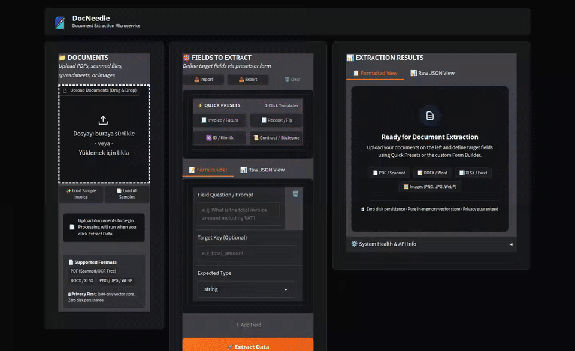
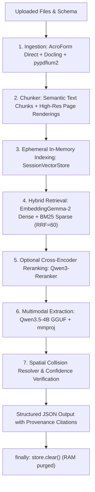
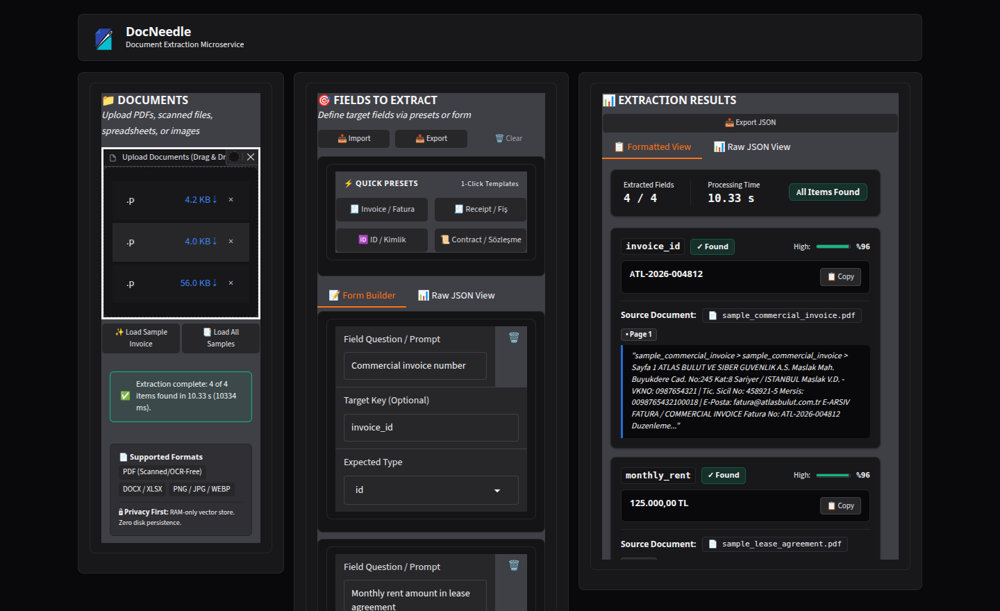

<p align="center">
  
</p>

<h1 align="center">DocNeedle</h1>

<p align="center">
  <strong>Enterprise-Grade Local Document Extraction Microservice & Interactive Platform</strong><br/>
  Extract schema-governed structured data with auditable source citations and statistical confidence scoring using local, in-process neural models.<br/>
  Zero external API reliance, strict zero-disk volatile memory guarantees, and OCR-free visual RAG.
</p>

<p align="center">
  
  
  
  
  
  
  
  
</p>

<p align="center">
  
</p>

---

## Table of Contents

- [Overview](#overview)
- [Key Features](#key-features)
- [Tech Stack](#tech-stack)
- [Benchmark](#benchmark--extractbench-leaderboard-comparison)
- [Prerequisites](#prerequisites)
- [Getting Started](#getting-started)
- [System Architecture](#system-architecture)
- [Web Dashboard](#web-dashboard-gradio-6-ui)
- [API Reference](#api-reference)
- [Configuration Reference](#configuration-reference)
- [Available Scripts](#available-scripts)
- [Testing](#testing)
- [Production Deployment](#production-deployment)
- [Troubleshooting](#troubleshooting--faqs)
- [Contributing](#contributing)
- [License](#license)

---

## Overview

**DocNeedle** is a privacy-first local document extraction microservice with an interactive web application. It ingests unstructured documents (**PDF**, **DOCX**, **XLSX**, high-resolution **images**) together with a user-defined JSON schema, and returns target values with exact textual citations, source document provenance, page numbers, and confidence scores.

Unlike pipelines built on cloud APIs or brittle OCR engines, DocNeedle provides:

- **Zero cloud reliance:** All models run in-process via native multi-architecture `llama.cpp` bindings and C++ shared libraries with hardware acceleration.
- **Zero-disk privacy:** Payloads, embeddings, and indices live only in volatile RAM and are purged unconditionally after each request (`store.clear()`).
- **OCR-free visual RAG:** Digital PDFs are parsed for text and tables; scanned documents and images are ingested as high-resolution page chunks, embedded cross-modally (SigLIP projector) and read directly by the multimodal Qwen3.5-4B LLM.
- **High-throughput asynchronous concurrency:** Modern Python async pipeline for multi-core parsing, Docling chunking, and non-blocking HTTP streaming.

---

## Key Features

- **Zero-Disk Persistence:** `SessionVectorStore` is strictly in-memory; vectors, chunks, and temp files are cleared in `finally: store.clear()`.
- **In-Process Multimodal Models:**
  - **LLM:** Qwen3.5-4B GGUF (`Qwen3.5-4B-Q4_K_M.gguf` + `mmproj-Qwen3.5-4B-F16.gguf`), schema-constrained JSON extraction.
  - **Cross-Modal Embedder:** EmbeddingGemma-2 GGUF (`embeddinggemma-2-UD-Q4_K_XL.gguf` + `mmproj-F16.gguf`), unified text and visual page embeddings.
  - **Reranker:** Qwen3-Reranker-0.6B GGUF (`Qwen3-Reranker-0.6B.Q4_K_M.gguf`), optional cross-encoder scoring.
- **Native C++ Embedder:** `libdocneedle_embed.so` (loaded via `ctypes`) runs GGUF inference and SigLIP projection without intermediate serialization.
- **AcroForm Direct Extraction:** Interactive PDF form fields are parsed via `pypdfium2` (`ingest/acroform.py`) before chunking, with no hallucination.
- **Spatial Collision Resolution:** `SpatialCollisionResolver` (`extraction/collision.py`) assigns a repeated salient value only to the field with the highest context affinity.
- **FP16 / Quantized KV Cache & Flash Attention:** High-speed Flash Attention with quantized/FP16 KV cache (`model_kv_cache_type_k = 1`, `model_kv_cache_type_v = 8` [Q8_0], configurable to FP16) supporting a 32,768-token window in compact VRAM.
- **Speculative Prompt Lookup Decoding:** `LlamaPromptLookupDecoding` (`max_ngram_size=2`, `num_pred_tokens=5`), opt-in.
- **Hybrid RRF Retrieval:** Dense cosine + Okapi BM25 fused via Reciprocal Rank Fusion ($RRF=60$) with document-diversity constraints.
- **Unified UI + REST API:** Dark-mode Gradio 6 dashboard and FastAPI on the same port (`7860`), with SSE streaming for async jobs.
- **ZeroGPU & Multi-Arch CUDA:** Precompiled multi-architecture CUDA binaries (embedded `sm_80`, `sm_86`, `sm_89`, `sm_120a` kernels in `libggml-cuda.so`); dynamic leasing via `@spaces.GPU`.

---

## Tech Stack

| Layer | Technologies |
| :--- | :--- |
| **Runtime** | Python 3.14+ (Modern Async & Multi-Core) |
| **Microservice** | FastAPI 0.115+, Uvicorn 0.32+, Pydantic v2, Pydantic-Settings |
| **Web Dashboard** | Gradio 6+, dark mode, dynamic schema builder, formatted/raw JSON tabs |
| **Ingestion** | Docling Core 2.15+, pypdfium2, python-docx, openpyxl, Pillow |
| **AcroForm** | pypdfium2 native bindings (`FPDFPage_GetAnnot`, `FPDFAnnot_GetFormFieldValue`) |
| **Embeddings** | EmbeddingGemma-2 UD-Q4_K_XL GGUF + SigLIP mmproj-F16 (768 dim), native `libdocneedle_embed.so` |
| **Lexical Search** | rank-bm25 (Okapi BM25) |
| **Reranker** | Qwen3-Reranker-0.6B Q4_K_M GGUF (llama.cpp logit scoring) |
| **LLM Engine** | Qwen3.5-4B-Q4_K_M GGUF + mmproj-Qwen3.5-4B-F16 (32k context, Flash Attention) |
| **Inference Backend** | llama-cpp-python 0.3.x with CUDA/cuBLAS |
| **Packaging & Deployment** | `uv`, Hugging Face Spaces (ZeroGPU A10G / A100) |

---

## Benchmark & ExtractBench Leaderboard Comparison

### Overview & Methodology

DocNeedle was evaluated on **[ExtractBench](https://www.extractbench.ai/)** ([LlamaIndex](https://github.com/run-llama/ExtractBench), [arXiv:2607.29677](https://arxiv.org/abs/2607.29677)), an enterprise benchmark for schema-guided document extraction: **370 documents**, **4,869 pages**, **13,577 annotated fields** across scanned invoices, regulatory forms, bank statements, contracts, multi-page financial tables, and handwritten notations.

- **Short (252 docs, 10,676 fields):** up to 10 pages.
- **Medium (98 docs, 2,808 fields):** 11–50 pages.
- **Long (20 docs, 93 fields):** over 50 pages.

Tracked metrics: **Unified Value F1** (failed documents score 0), **Page Grounding Accuracy**, **Strict Null Accuracy** (no hallucination for absent fields), **Cost per Page**, and **Data Privacy & Disk Security**.

### Curated Leaderboard Comparison

Source: official `leaderboard.csv` from [run-llama/ExtractBench](https://github.com/run-llama/ExtractBench) ([leaderboard](https://www.extractbench.ai/#leaderboard)).

| System / Model | Provider / Category | Architecture & Size | Overall F1 | Short (≤10p) | Medium (11-50p) | Long (>50p) | Page Grounding | Cost / Page | Privacy & Storage |
| :--- | :--- | :--- | :---: | :---: | :---: | :---: | :---: | :---: | :--- |
| **LlamaExtract Agentic Plus** | LlamaIndex | Cloud Agentic Pipeline | **96.17%** | 97.02% | 94.30% | 94.65% | 88.26% | $0.0750 | Cloud API (External) |
| **Codex (GPT-6.1 Sol Evidence)** | OpenAI / Codex | Frontier Coding Agent | **95.31%** | 97.01% | 92.96% | 85.46% | 89.37% | $0.0713 | Cloud API (External) |
| **Claude Code (Sonnet 5.5 Evidence)** | Anthropic | Frontier Coding Agent | **94.68%** | 96.22% | 92.97% | 83.69% | 75.99% | $0.0569 | Cloud API (External) |
| **OpenAI GPT-6 Astra** | OpenAI | Commercial Frontier VLM | **91.91%** | 97.22% | 90.56% | 31.70% | 0.00% *(N/A)* | $0.1109 | Cloud API (External) |
| **Qwen3.5 4B (Raw Base Model)** | Alibaba / OSS | Standalone Base Model | **82.43%** | 89.06% | 76.64% | 27.31% | 0.00% *(N/A)* | Free (self-host) | Self-Hosted / Local |
| **Google Gemini 3.8 Flash** | Google | Commercial Fast VLM | **80.71%** | 88.14% | 72.23% | 28.70% | 0.00% *(N/A)* | $0.0043 | Cloud API (External) |
| **DocNeedle (In-Process)** | **DocNeedle** | **Qwen3.5-4B + Gemma2-RAG** | **75.71%** | **77.16%** | **69.70%** | **71.43%** | **80.95%** | **$0.00 (on-premise)** | **Zero-Disk RAM / Air-Gapped** |

> [!TIP]
> **Model-agnostic scaling:** The published results (**75.71% Overall F1**, **90.67% Short Grounding**) use a compact **4B model** (`Qwen3.5-4B-Q4_K_M`, ~2.6 GB VRAM) and a **0.6B embedder** to validate operation on commodity hardware (8 GB VRAM minimum, or multi-core CPUs). Ingestion, AcroForm parsing, hybrid RAG, and collision resolution are model-agnostic, so larger weights (e.g. **Qwen3.5-9B**, **Qwen3.5-35B**) offer a scaling path toward **88%–95%+ F1** while keeping zero-disk privacy and zero per-page fees.

### Key Insights & Trade-offs

- **Long-Document Resilience (+44.12 pts vs. base model):** Beyond 50 pages, unaugmented models suffer attention degradation (raw Qwen3.5 4B drops from 89.06% to 27.31%, GPT-6 Astra to 31.70%). DocNeedle sustains **71.43% F1** (2.6× improvement) by routing relevant visual/text chunks into a bounded context.
- **Auditable Page Grounding (90.67% short, 80.95% overall):** Unlike raw VLMs that score 0.00% on source attribution, DocNeedle pairs every extracted value with verified page numbers and verbatim text snippets.
- **Deterministic Form Extraction:** Native PDF AcroForm parsing via `pypdfium2` extracts interactive checkboxes and field inputs without OCR artifacts.
- **Local Privacy & Predictable Costs:** Runs 100% in-process with zero network telemetry; vectors and chunk images reside in volatile RAM and are wiped via `finally: store.clear()`.
- **Engineering Trade-offs:** Dense single-page documents may experience retrieval filtering on isolated clauses (77.16% F1 vs. 89.06% unconstrained base model), requiring balanced context windows.

### Detailed Results by Split

Generated by `scripts/benchmark_extractbench.py` and stored in `benchmark_results/`:

| Metric | Short (≤10p) | Medium (11-50p) | Long (>50p) | Full (370 docs) |
| :--- | :---: | :---: | :---: | :---: |
| **Documents** | 252 | 98 | 20 | **370** |
| **Target Fields** | 10,676 | 2,808 | 93 | **13,577** |
| **Strictly Matched Fields** | 8,759 | 2,153 | 60 | **10,972** |
| **Unified Value F1** | **77.16%** | **69.70%** | **71.43%** | **75.71%** |
| **Value Precision** | **81.00%** | **79.43%** | **80.88%** | **80.73%** |
| **Value Recall** | **73.66%** | **62.10%** | **63.95%** | **71.27%** |
| **Page Grounding** | **90.67%** | **62.14%** | **50.58%** | **80.95%** |
| **Strict Null Accuracy** | **81.92%** | **84.62%** | **27.78%** | **82.35%** |
| **Perfect Documents Rate** | 1.98% (5) | 1.02% (1) | 0.00% (0) | **1.62% (6)** |

### Reproducing the Benchmark

```bash
uv run python app.py                                                          # 1. start the server (default port 7860)
uv run python scripts/benchmark_extractbench.py --split short --api-url http://localhost:7860  # 2. short split
uv run python scripts/benchmark_extractbench.py --split all --api-url http://localhost:7860    # 3. all 370 documents
cat benchmark_results/summary_short.json benchmark_results/summary_all.json                     # 4. view summaries
```

Per-document logs, ground-truth diffs, and summary metrics are saved to `benchmark_results/`.

---

## Prerequisites

- **OS:** Linux (Ubuntu 22.04/24.04, Debian 12, Arch, Fedora recommended). On Windows, use WSL2 (Ubuntu 22.04/24.04 recommended); native Windows and macOS are not supported because the bundled native libraries (`libdocneedle_embed.so`, `libllama.so`, `libggml-*.so`) are Linux ELF binaries.
- **RAM:** 8 GB minimum (16 GB recommended for CPU-only inference).
- **GPU (optional):** NVIDIA, CUDA 12.0+, Compute Capability ≥ 8.0 (RTX 30/40/50, A100, H100, Blackwell). Fits within 8 GB VRAM (minimum).
- **Storage:** ~5 GB for model weights and tokenizers.
- **System packages** (OpenGL and GLib for Docling/pypdfium2):

```bash
# Ubuntu / Debian
sudo apt-get update && sudo apt-get install -y build-essential cmake curl git libgl1 libglib2.0-0
# Fedora / RHEL
sudo dnf install -y gcc gcc-c++ cmake curl git mesa-libGL glib2
# Arch Linux
sudo pacman -S base-devel cmake curl git mesa glib2
```

- **[`uv`](https://github.com/astral-sh/uv):**

```bash
curl -LsSf https://astral.sh/uv/install.sh | sh
```

---

## Getting Started

### 1. Clone and Create the Environment

```bash
git clone https://github.com/N4YuC4/DocNeedle.git
cd DocNeedle

uv venv
source .venv/bin/activate
```

### 2. Install Dependencies

```bash
uv sync
```

> [!NOTE]
> To compile `llama-cpp-python` with CUDA locally, export the toolkit paths first:
> ```bash
> export CUDACXX=/usr/local/cuda/bin/nvcc
> export CMAKE_ARGS="-DGGML_CUDA=on -DCMAKE_CUDA_ARCHITECTURES=native"
> uv pip install --no-build-isolation "llama-cpp-python>=0.3.0,<0.4.0"
> ```

### 3. Download Quantized Models

```bash
uv run python scripts/download_models.py
```

Automatically downloads the required quantized weights (~4.5 GB) into `models/` (EmbeddingGemma-2 cross-modal embedder, Qwen3.5-4B GGUF, SigLIP vision projectors, and reranker). Pass `--embedding`, `--reranker`, or `--llm` to download specific groups.

### 4. Configure

Settings load from `config.toml`; optionally override via `.env` (`cp .env.example .env 2>/dev/null || touch .env`). Key defaults:

- `gpu_enabled = true`: CUDA acceleration enabled across all models (LLM, Embedding, Reranker).
- `llm_n_gpu_layers = -1`, `embedding_n_gpu_layers = -1`, `reranker_n_gpu_layers = -1`: offload all layers to GPU (`0` = CPU).
- `reranker_enabled = true`: cross-encoder neural reranking enabled by default for maximum citation accuracy.

### 5. Launch

**Unified Gradio UI + FastAPI (default, port `7860`):**

```bash
uv run python app.py
```

- Dashboard: [http://localhost:7860](http://localhost:7860)
- Swagger: [http://localhost:7860/docs](http://localhost:7860/docs) · ReDoc: [http://localhost:7860/redoc](http://localhost:7860/redoc)
- Health: [http://localhost:7860/healthz](http://localhost:7860/healthz)

**API-only server (port `8000`):**

```bash
uv run uvicorn docneedle.main:app --host 0.0.0.0 --port 8000 --reload
```

---

## System Architecture

### Directory Structure

```
DocNeedle/
├── assets/                       # Logo (SVG) and static icons
├── app.py                        # Unified Gradio 6 UI + FastAPI root mount & ZeroGPU entry
├── config.toml                   # Application, model & pipeline configuration
├── pyproject.toml / requirements.txt
├── Dockerfile / docker-compose.yml
├── scripts/
│   ├── download_models.py        # Model downloader with verification
│   ├── benchmark_extractbench.py # ExtractBench runner (Value F1, Grounding F1)
│   └── deploy_space.sh           # Hugging Face Spaces (ZeroGPU) deployment
├── models/                       # embedding/, reranker/, llm/ (GGUF + projectors)
├── src/docneedle/
│   ├── main.py                   # FastAPI factory, CORS, /healthz
│   ├── config.py                 # Pydantic BaseSettings (TOML + env)
│   ├── hardening.py              # Linux kernel PR_SET_DUMPABLE anti-dump protection
│   ├── cuda_compat.py            # ZeroGPU preloaders & memory leasing wrappers
│   ├── api/                      # routes_extract.py, routes_jobs.py, validation.py ($ref, size checks)
│   ├── jobs/                     # models.py, manager.py (in-memory registry, SSE queues, TTL)
│   ├── ingest/                   # parser.py, chunker.py, acroform.py, cache.py, service.py, models.py
│   ├── retrieval/                # embedder.py, docneedle_embed.cpp, libdocneedle_embed.so,
│   │                             # worker.py (process-isolated embedder), bm25.py, reranker.py,
│   │                             # store.py (SessionVectorStore, RRF), models.py
│   ├── extraction/               # service.py, verifier.py, matcher.py, collision.py, schemas.py
│   └── llm/                      # local_engine.py, client.py, handlers.py, parsing.py,
│                                 # prompts.py, speculative.py
└── tests/                        # Pytest suite (see Testing)
```

### End-to-End Extraction Lifecycle



### OCR-Free Visual RAG & Digital Text Ingestion

DocNeedle natively ingests PDFs, Office documents (`.docx`, `.xlsx`, `.xls`), web pages (`.html`, `.htm`), delimited text (`.csv`, `.tsv`, `.txt`, `.md`, `.json`, `.xml`), and image formats (`.png`, `.jpg`, `.jpeg`, `.webp`, `.tiff`, `.bmp`).

1. **Digital documents:** With an embedded text layer (`pdf_embedded_text_min_chars = 50`), Docling extracts markdown, headings, and tables; rasterized pages are preserved alongside.
2. **Scanned documents & images:** Pages are rasterized at 150 DPI and embedded cross-modally via SigLIP. The raw page image goes directly to the multimodal LLM, which improves fidelity on handwriting, stamps, receipts, and low-contrast scans.

### Interactive PDF AcroForm Extraction

`src/docneedle/ingest/acroform.py` inspects form fields via `pypdfium2.raw` (`FPDFPage_GetAnnot`, `FPDFAnnot_GetFormFieldType`), reads names, alternate descriptions, and values from UTF-16LE form streams, formats them as markdown tables, and injects them into the chunks before retrieval, giving deterministic accuracy on interactive forms.

### Spatial Collision Resolution

LLMs may repeat one salient number or entity across several unpopulated fields. `SpatialCollisionResolver` (`extraction/collision.py`):

1. Detects duplicate non-trivial values across distinct schema items.
2. Counts occurrences of the value on candidate pages.
3. If the value occurs only once, scores context affinity between each field description and the text around the value.
4. Assigns the value to the highest-affinity field and resets the others to `found: False, value: None`.

### Native C++ Cross-Modal Embedding Engine

`src/docneedle/retrieval/docneedle_embed.cpp` is compiled to `libdocneedle_embed.so` and loaded via `ctypes`. It embeds text (`instruction: "task: search result | query: {text}"`) and raw image bytes into one 768-dimensional L2-normalized space. Precompiled multi-architecture CUDA kernels embedded directly in `libggml-cuda.so` (supporting `sm_80`, `sm_86`, `sm_89`, and `sm_120a`) ensure immediate startup on modern NVIDIA GPUs without runtime compilation.

### Zero-Disk Privacy Guarantee

1. **No external telemetry:** Embeddings and inference run in-process; no cloud endpoint is contacted.
2. **Volatile indices:** Embeddings and chunk graphs exist only in RAM within `SessionVectorStore`.
3. **Ephemeral cleanup:**
   ```python
   store = SessionVectorStore()
   try:
       store.add_chunks(chunks)
       # ... retrieval & extraction ...
       return response
   finally:
       store.clear()  # deallocates chunk buffers immediately
   ```
4. **Zero temporary disk files:** Uploaded payloads and documents are parsed entirely in-memory using `io.BytesIO` streams with zero temporary disk files created or unlinked.
5. **Async job TTL:** Cached job results expire after `job_retention_minutes` (default 15).

### Security Hardening & CI Enforcement

DocNeedle enforces privacy guarantees at the kernel and container level:

**Kernel-Level Hardening:**
- `PR_SET_DUMPABLE=0` via `prctl()` — prevents core dumps from leaking RAM contents
- Verified in CI via `test_zero_disk.py` subprocess crash tests

**Container Hardening (`docker-compose.prod.yml`):**
- Read-only root filesystem (`read_only: true`)
- RAM-backed `/tmp` via tmpfs (1GB, `noexec`, `nosuid`)
- Core dump size limited to 0 (`ulimits: core: 0`)
- Offline Hugging Face mode (`HF_HUB_OFFLINE=1`)

**CI/CD Pipeline (GitHub Actions):**
| Job | Purpose |
|---|---|
| `lint-and-unit-tests` | 159 tests, ruff, zero-disk parser validation |
| `container-zero-disk-enforcement` | Read-only rootfs + tmpfs Docker test |
| `container-service-smoke` | Health check, 415 fail-fast, kernel log verification |

### Supported Data Types & Validation Rules

| Type Key | Description | Example | Validation Rule |
| :--- | :--- | :--- | :--- |
| `string` | Free text | Any phrase or sentence | Trimmed string |
| `number` | Numeric quantity | `42`, `3.14`, `1,250` | Strips commas/spaces, verifies numeric |
| `money` | Amount with currency | `25.000 TL`, `$4,500.00`, `€120` | Amount + currency symbol/code |
| `date` | ISO or localized date | `2024-10-15`, `15/10/2024` | Format & calendar sanity |
| `time` | Clock time or duration | `14:30`, `09:00 AM`, `45 mins` | 12h/24h patterns |
| `email` | Email address | `contact@docneedle.org` | RFC 5322 regex |
| `phone` | Phone number | `+90 555 123 4567` | Digit count & country codes |
| `id` | Identification number | National ID, passport, plate | Alphanumeric identifier |
| `iban` | Bank account number | `TR33 0006 1005 1234 5678 9012 34` | Format & checksum |
| `percentage` | Percentage | `18%`, `2.5 %` | Extracts number before `%` |
| `person` | Human name | `Tolga Arslan`, `Dr. Jane Doe` | Capitalized name syntax |
| `organization` | Company or entity | `Acme Corp` | Entity keywords & casing |
| `address` | Street address | `Ataturk Cad. No: 12 Kadikoy/Istanbul` | Filters header timestamps |
| `boolean` | Binary condition | `true`, `false`, `yes`, `no` | Normalized to `True`/`False` |
| `list` / `array` | Delimited items | `Apple; Banana; Orange` | Split into typed items |

### Recursive JSON Schema Dereferencing (`$ref`)

`src/docneedle/api/validation.py` dereferences internal pointers (`#/definitions/Item`, `#/$defs/Item`) up to 20 levels deep and accepts both flat item arrays (`[{"key": "total", "type": "money", ...}]`) and nested JSON Schema objects.

---

## Web Dashboard (Gradio 6 UI)

<p align="center">
  
</p>

Served at `http://localhost:7860`, matching the REST API:

- **Schema Builder:** Add, edit, or remove fields visually with type dropdowns.
- **Raw JSON Schema Tab:** Bidirectional sync with the visual builder.
- **Multi-Document Upload:** PDFs, Word, Excel, and images via drag & drop.
- **Live Progress:** SSE-driven progress bar with current step, field key, and percentage.
- **Dual Output:** Formatted cards (confidence badges, values, highlighted citations) and raw JSON matching the `/v1/extract` contract.

---

## API Reference

| Method | Endpoint | Description |
| :--- | :--- | :--- |
| `GET` | `/` | Service info, docs links, version (JSON on port 8000; Gradio UI on port 7860) |
| `GET` | `/healthz`, `/health` | Diagnostics (Runtime, GPU/CUDA, models, job queue, config); `/health` is an alias |
| `POST` | `/v1/extract` | **Synchronous** extraction (415 for unsupported formats) |
| `POST` | `/v1/jobs` | **Asynchronous** extraction (415 for unsupported formats) |
| `GET` | `/v1/jobs/{job_id}` | Poll job progress and results |
| `GET` | `/v1/jobs/{job_id}/events` | **SSE** real-time job events |
| `GET` | `/docs`, `/redoc` | Swagger / ReDoc documentation |

### 1. Synchronous Extraction (`POST /v1/extract`)

Multipart form-data parameters:

| Parameter | Type | Required | Description |
| :--- | :--- | :--- | :--- |
| `files` | `binary[]` | Yes | One or more files (PDF, DOCX, XLSX, HTML, CSV, TXT, MD, PNG, JPG, WEBP, TIFF) |
| `schema` | `string` | Yes | JSON array of target keys, descriptions, and types |
| `enable_reranker` | `boolean` | No | Overrides reranking; defaults to `config.toml` |

**Error Responses:**
| Status | Condition |
|---|---|
| 415 | Unsupported file extension (validation before memory spooling) |
| 413 | File exceeds max_upload_size_mb or max_total_upload_size_mb |
| 400 | Invalid schema JSON, empty schema, or exceeds max_schema_items / max_upload_files |
| 422 | No readable text or content extracted from documents |

```bash
curl -X POST "http://localhost:7860/v1/extract" \
  -F "files=@contract.pdf" \
  -F 'schema=[
    {"key": "monthly_rent", "description": "Agreed monthly rent amount", "type": "money"},
    {"key": "tenant_name", "description": "Full legal name of the tenant", "type": "person"}
  ]'
```

Python (`httpx`):

```python
import httpx, json

schema = [
    {"key": "monthly_rent", "description": "Agreed monthly rent amount", "type": "money"},
    {"key": "tenant_name", "description": "Full legal name of the tenant", "type": "person"},
]
files = [("files", ("contract.pdf", open("contract.pdf", "rb"), "application/pdf"))]
data = {"schema": json.dumps(schema), "enable_reranker": "false"}

with httpx.Client(timeout=120.0) as client:
    response = client.post("http://localhost:7860/v1/extract", files=files, data=data)
    print(json.dumps(response.json(), indent=2))
```

Response (`200 OK`):

```json
{
  "status": "completed",
  "processing_time_ms": 910.5,
  "total_items": 2,
  "found_items": 2,
  "results": [
    {
      "key": "monthly_rent", "found": true, "value": "25.000 TL", "confidence": 0.96,
      "evidence": {"document": "contract.pdf", "page": 1,
                   "snippet": "Kira Bedeli: Aylık 25.000 TL olup her ayın 5. gününe kadar ödenecektir."},
      "thinking": null
    },
    {
      "key": "tenant_name", "found": true, "value": "Tolga Arslan", "confidence": 0.95,
      "evidence": {"document": "contract.pdf", "page": 1,
                   "snippet": "KİRACI: Tolga Arslan (T.C. Kimlik No: 12345678901)"},
      "thinking": null
    }
  ]
}
```

### 2. Asynchronous Job Creation (`POST /v1/jobs`)

For large documents or batch workflows. Returns `202 Accepted` immediately with polling and SSE URLs.

```bash
curl -X POST "http://localhost:7860/v1/jobs" \
  -F "files=@annual_report.pdf" \
  -F 'schema=[
    {"key": "total_revenue", "description": "Total consolidated revenue", "type": "money"},
    {"key": "net_profit", "description": "Net annual operating profit", "type": "money"}
  ]'
```

```json
{
  "job_id": "job_01jcb7x4e8rfb9q2",
  "status": "pending",
  "poll_url": "/v1/jobs/job_01jcb7x4e8rfb9q2",
  "events_url": "/v1/jobs/job_01jcb7x4e8rfb9q2/events",
  "created_at": 1730390400.125
}
```

### 3. Job Status Polling (`GET /v1/jobs/{job_id}`)

```bash
curl -X GET "http://localhost:7860/v1/jobs/job_01jcb7x4e8rfb9q2"
```

```json
{
  "job_id": "job_01jcb7x4e8rfb9q2",
  "status": "extracting",
  "progress": {"current_step": "Extracting: total_revenue", "total_items": 2,
               "completed_items": 1, "current_key": "total_revenue", "percent": 50.0},
  "created_at": 1730390400.125,
  "completed_at": null,
  "processing_time_ms": null,
  "results": [
    {"key": "net_profit", "found": true, "value": "$12.4M", "confidence": 0.95,
     "evidence": {"document": "annual_report.pdf", "page": 4,
                  "snippet": "Net profit for the fiscal year reached $12.4M."},
     "thinking": null}
  ],
  "response": null,
  "error": null
}
```

### 4. Real-Time SSE Streaming (`GET /v1/jobs/{job_id}/events`)

```bash
curl -N "http://localhost:7860/v1/jobs/job_01jcb7x4e8rfb9q2/events"
```

```
event: status
data: {"status": "pending", "progress": {"current_step": "Queued in memory", "total_items": 2, "completed_items": 0, "current_key": null, "percent": 0.0}, "results": []}

event: progress
data: {"status": "parsing", "progress": {"current_step": "Parsing: annual_report.pdf (1240.2 KB)...", "total_items": 2, "completed_items": 0, "current_key": null, "percent": 15.0}}

event: progress
data: {"status": "extracting", "progress": {"current_step": "Extracting: total_revenue", "total_items": 2, "completed_items": 1, "current_key": "total_revenue", "percent": 60.0}}

event: item_extracted
data: {"key": "total_revenue", "found": true, "value": "$84.2M", "confidence": 0.96, "evidence": {"document": "annual_report.pdf", "page": 4, "snippet": "Consolidated total revenue reached $84.2M."}, "thinking": null}

event: completed
data: {"status": "completed", "processing_time_ms": 2840.0, "total_items": 2, "found_items": 2, "results": [{"key": "total_revenue", "found": true, "value": "$84.2M", "confidence": 0.96, "evidence": {"document": "annual_report.pdf", "page": 4, "snippet": "Consolidated total revenue reached $84.2M."}, "thinking": null}]}
```

Python consumer:

```python
import httpx, json

events_url = "http://localhost:7860/v1/jobs/job_01jcb7x4e8rfb9q2/events"
with httpx.Client(timeout=None) as client:
    with client.stream("GET", events_url) as stream:
        for line in stream.iter_lines():
            if line.startswith("data: "):
                print("Received SSE:", json.loads(line[6:]))
```

### 5. Health & Hardware Diagnostics (`GET /healthz`)

Returns runtime environment, CUDA/GPU hardware, model readiness, job counts, and active configuration:

```json
{
  "status": "healthy",
  "service": "DocNeedle",
  "version": "0.1.0",
  "uptime_seconds": 1284.5,
  "process_memory_mb": 415.0,
  "python_version": "3.14.4",
  "hardware": {
    "device": "cuda",
    "gpu_enabled": true,
    "backend": "llama.cpp",
    "gpu_offload_supported": true,
    "cuda_runtime_detected": true,
    "cuda_visible_devices": null,
    "spaces_zero_gpu": null
  },
  "models": {
    "all_ready": true,
    "llm": {"name": "Qwen3.5-4B-Q4_K_M.gguf", "ready": true, "size_mb": 2614.0},
    "llm_mmproj": {"name": "mmproj-Qwen3.5-4B-F16.gguf", "ready": true, "size_mb": 641.3},
    "embedding": {"name": "embeddinggemma-2-UD-Q4_K_XL.gguf", "ready": true, "size_mb": 167.5},
    "embedding_mmproj": {"name": "mmproj-F16.gguf", "ready": true, "size_mb": 935.5},
    "reranker": {"name": "Qwen3-Reranker-0.6B.Q4_K_M.gguf", "ready": true, "size_mb": 378.1}
  },
  "jobs": {
    "active_jobs": 0,
    "total_cached_jobs": 2
  },
  "config": {
    "embedding_model": "unsloth/embeddinggemma-2-GGUF",
    "embedding_quantization": "ud-q4_k_xl",
    "llm_model": "Qwen3.5-4B-Q4_K_M",
    "llm_speculative_enabled": false,
    "multimodal_embedding": true,
    "multimodal_llm": true,
    "reranker_enabled": true,
    "gpu_enabled": true,
    "llm_n_gpu_layers": -1,
    "embedding_n_gpu_layers": -1,
    "reranker_n_gpu_layers": -1,
    "cpu_threads": 6,
    "max_upload_size_mb": 100,
    "max_total_upload_size_mb": 100,
    "max_schema_items": 50
  }
}
```

---

## Configuration Reference

Settings load from `config.toml` and can be overridden by `.env` files or OS environment variables.

### Configuration File (`config.toml`)

```toml
[server]
app_name = "DocNeedle"
app_version = "0.1.0"
debug = false
host = "0.0.0.0"
port = 8000
cors_origins = [
    "http://localhost:3000",
    "http://127.0.0.1:3000",
    "http://localhost:5173",
    "http://127.0.0.1:5173",
    "https://docneedle.vercel.app",
    "*"
]

[hardware]
gpu_enabled = true             # CUDA GPU offload (auto-detected on ZeroGPU)
llm_n_gpu_layers = -1          # -1 = all layers on GPU; 0 = CPU
embedding_n_gpu_layers = -1    # -1 = all embedding layers on GPU
reranker_n_gpu_layers = -1     # -1 = all reranker layers on GPU
model_n_batch = 512            # Logical batch size for prompt evaluation
model_n_ubatch = 512           # Physical micro-batch size for GPU kernels
reranker_n_ctx = 2048          # Reranker context window
model_kv_cache_type_k = 1      # 1 = GGML_TYPE_F16 (stable FP16 KV cache)
model_kv_cache_type_v = 8      # 8 = GGML_TYPE_Q8_0 (quantized V cache; 1 = FP16)
model_flash_attn = true        # Flash Attention

[ingest]
max_upload_size_mb = 100
pdf_render_scale = 1.5         # 150 DPI page rendering for visual chunks
pdf_embedded_text_min_chars = 50 # Minimum text length to treat a PDF as digital
pdf_embedded_text_max_check_pages = 5
ingestion_cache_enabled = true

[chunker]
tokenizer_model = "Qwen/Qwen3-Reranker-0.6B"
max_tokens = 768
repeat_table_header = true     # Repeat headers across table chunks
merge_peers = true
max_chunk_chars = 4000
min_split_chars = 200
overflow_factor = 1.25

[bm25]
k1 = 1.5                       # Term frequency saturation
b = 0.75                       # Length normalization
top_k = 10

[embedding]
model = "unsloth/embeddinggemma-2-GGUF"
quantization = "ud-q4_k_xl"
dimension = 768
batch_size = 4
instruction = "task: search result | query: {text}"
doc_instruction = "title: {doc_name} | text: {text}"

[retrieval]
top_k = 10                     # Candidates from RRF hybrid search
rrf_constant = 60
reranker_enabled = true        # Qwen3 cross-encoder (enabled by default on GPU)
reranker_model = "Qwen/Qwen3-Reranker-0.6B"
reranker_candidate_k = 4
rerank_top_k = 3
max_chunks_per_document = 2    # Prevent single-document dominance
reranker_instruction = "Given a web search query, retrieve relevant passages that answer the query"

[llm]
model_name = "Qwen3.5-4B-Q4_K_M"
mmproj_name = "mmproj-Qwen3.5-4B-F16"
n_ctx = 32768                  # 32k context window
temperature = 0.0              # Greedy decoding for deterministic extraction
top_p = 0.95
max_tokens = 4096
single_field_max_tokens = 128
thinking_max_tokens = 512
enable_thinking = false
log_extraction_payloads = false
stop_tokens = ["<|im_end|>", "<|endoftext|>", "</s>"]
speculative_enabled = false    # Prompt lookup decoding
speculative_cpu_enabled = false
speculative_max_vocab_size = 65536
speculative_num_pred_tokens = 5
speculative_max_ngram_size = 2

[extraction]
top_k = 5
schema_batch_size = 35
context_delimiter = "\n\n---\n\n"
confidence_found_score = 0.95
confidence_not_found_score = 0.0
job_retention_minutes = 15     # In-memory TTL for async job results
model_storage_dir = "models"

[security]
max_schema_items = 50          # Target items per request
max_upload_files = 20          # Documents per batch
max_total_upload_size_mb = 100 # Batch payload limit
max_concurrent_jobs = 10       # Parallel background jobs
```

### Environment Variables

| Variable | Description | Default |
| :--- | :--- | :--- |
| `GPU_ENABLED` | Enable CUDA acceleration (`true`/`false`) | `true` |
| `LLM_N_GPU_LAYERS` | LLM layers offloaded to GPU (`-1` = all, `0` = CPU) | `-1` |
| `MODEL_STORAGE_DIR` | Path to downloaded GGUF models | `models` |
| `CONFIG_TOML` | Custom configuration file path | `config.toml` |
| `RERANKER_ENABLED` | Enable reranker by default | `true` |
| `HOST` | Bind interface | `0.0.0.0` |
| `PORT` | Listening port | `7860` (app.py) / `8000` (uvicorn) |
| `DEBUG` | Verbose debug logging | `false` |
| `SPACES_ZERO_GPU` | ZeroGPU leasing flag (auto-set by Hugging Face) | `None` |

---

## Available Scripts

| Command | Description |
| :--- | :--- |
| `uv run python app.py` | Unified Gradio UI + FastAPI on port `7860` |
| `uv run uvicorn docneedle.main:app --reload` | API-only dev server with hot reload (port `8000`) |
| `uv run python scripts/download_models.py [--embedding\|--llm\|--reranker]` | Download all models (~4.5 GB) or a single group |
| `uv run python scripts/benchmark_extractbench.py --split short` | Run the ExtractBench evaluation |
| `uv run pytest` | Full automated test suite (requires model weights) |
| `uv run pytest tests/ --ignore=tests/test_extraction.py --ignore=tests/test_multimodal_extraction.py --ignore=tests/test_retrieval.py --ignore=tests/test_jobs.py -v` | Fast unit test suite (159 tests, kernel hardening & zero-disk, no models needed) |
| `uv run pytest tests/test_health.py` | `/healthz` and route tests |
| `uv run ruff check . [--fix]` | Lint (optionally auto-fix) |
| `uv run ruff format .` | Format code (Python 3.14 profile) |
| `bash scripts/deploy_space.sh [SPACE_ID]` | Deploy to Hugging Face Spaces (ZeroGPU) |

---

## Testing

DocNeedle uses `pytest` and `pytest-asyncio` (`asyncio_mode = "auto"`).

```bash
# Fast unit tests (159 tests, <4 s, no model weights)
uv run pytest tests/ \
  --ignore=tests/test_extraction.py \
  --ignore=tests/test_multimodal_extraction.py \
  --ignore=tests/test_retrieval.py \
  --ignore=tests/test_jobs.py \
  -v

# Full end-to-end suite (requires model weights)
uv run pytest
```

> [!WARNING]
> While the dev server (`app.py`) runs, it holds ~7.1 GB of GPU VRAM. Running heavy end-to-end model tests concurrently causes CUDA OOM.
>
> **Recommendation:** Run lightweight unit tests while the server is active, or stop `app.py` before executing the full test suite.

---

## Production Deployment

### Hugging Face Spaces (ZeroGPU)

DocNeedle is designed for single-command deployment to Hugging Face **ZeroGPU** (NVIDIA A100 / A10G dynamic slices):

```bash
hf auth login
bash scripts/deploy_space.sh your-hf-username/docneedle
```

The script automatically executes the following:
1. Validates or provisions a public ZeroGPU Gradio Space (`--flavor zero-a10g`).
2. Synchronizes application source code, configuration, and assets (excluding local environments and caches).
3. Triggers automated quantized model bootstrap on container cold-start.
4. Monitors build and deployment status until the Space reaches `RUNNING`.

### Docker (Headless Production)

#### 1. Download Model Weights (Prerequisite)

Before launching the container, ensure quantized model weights are downloaded to the host's `models/` directory (mounted read-only into `/app/models`):

```bash
uv run python scripts/download_models.py
```

#### 2. Launch Container

**With NVIDIA GPU Acceleration (Recommended for Production):**

Requires `nvidia-container-toolkit` installed on the host.

```bash
docker compose -f docker-compose.prod.yml -f docker-compose.gpu.yml up -d --build
```

**CPU-Only Profile (or CI Environments):**

```bash
docker compose -f docker-compose.prod.yml up -d --build
```

This deployment:
- Starts a headless FastAPI microservice on port `8000` (no Gradio UI)
- Enforces strict zero-disk isolation via read-only rootfs (`read_only: true`) and RAM-backed `tmpfs` (1GB, `noexec`, `nosuid`)
- Directs CUDA JIT compilation cache to volatile memory via `CUDA_CACHE_PATH=/tmp/nv-cache`
- Activates and verifies Linux kernel anti-dump hardening (`PR_SET_DUMPABLE=0`) in container logs

#### 3. Verify Health & Perform Test Extraction

Verify that all neural models are active on GPU (`all_ready: true` and `device: "cuda"`):

```bash
curl -s http://localhost:8000/healthz | grep -o '"all_ready":[a-z]*'
# Expected: "all_ready":true
```

Execute an end-to-end extraction query against the containerized microservice:

```bash
curl -X POST "http://localhost:8000/v1/extract" \
  -F "files=@assets/examples/sample_lease_agreement.pdf" \
  -F 'schema=[{"key": "monthly_rent", "description": "Agreed monthly rent amount", "type": "money"}]'
```

> [!NOTE]
> CI environments build with `INSTALL_CPU_LLAMA=true` on CPU runners. Production deployments utilize the precompiled native multi-architecture CUDA wheel (`sm120`) via `docker-compose.gpu.yml`.

---

## Troubleshooting & FAQs

| Symptom | Cause | Solution |
| :--- | :--- | :--- |
| `libGL.so.1: cannot open shared object file` | Missing OpenGL runtime in headless Linux | `sudo apt-get install -y libgl1 libglib2.0-0` |
| `FileNotFoundError: Missing required model: ...` | Weights not downloaded or wrong `MODEL_STORAGE_DIR` | `uv run python scripts/download_models.py`, or `export MODEL_STORAGE_DIR=/path/to/models` |
| CUDA Out of Memory | Context size or layer offload exceeds VRAM | Lower `llm_n_gpu_layers` (e.g. `16`–`20`); keep `model_kv_cache_type_k/v = 1`; set `reranker_enabled = false` |
| `Address already in use` (7860 / 8000) | Port held by another instance | `lsof -i :7860` then `kill -9 <PID>`, or `PORT=7861 uv run python app.py` |
| `libdocneedle_embed.so: cannot open shared object file` | Native library missing from `src/docneedle/retrieval/` | Verify the file exists; to rebuild: `cd src/docneedle/retrieval && g++ -O3 -shared -fPIC -std=c++17 docneedle_embed.cpp -o libdocneedle_embed.so -I../../../.venv/lib/python3.14/site-packages/include -L. -Wl,-rpath,'$ORIGIN' -lllama -lggml_llamacpp -lggml-base -lggml-cpu -lmtmd` |
| `ModuleNotFoundError: No module named 'docneedle'` | Package not installed or `src` not on `PYTHONPATH` | `uv pip install -e .` |

---

## Contributing

Contributions are welcome. Please follow these standards:

1. **Fork and branch:** `git checkout -b feature/my-feature`.
2. **Strict no-fallback policy:** Maintain fail-fast behavior; do not introduce silent fallbacks, mock degradations, or fallback models.
3. **Privacy first:** Preserve the zero-disk persistence guarantee.
4. **Code quality:**
   ```bash
   uv run ruff check .
   uv run ruff format .
   uv run pytest tests/test_clean_modules.py tests/test_collision.py tests/test_acroform.py
   ```
5. **Pull request:** Describe motivation, implementation details, and verification steps.

---

## License

DocNeedle is released under the **[Apache License 2.0](LICENSE)**.  
You may use, modify, and distribute this software in commercial and non-commercial projects under the terms of the Apache 2.0 license.
